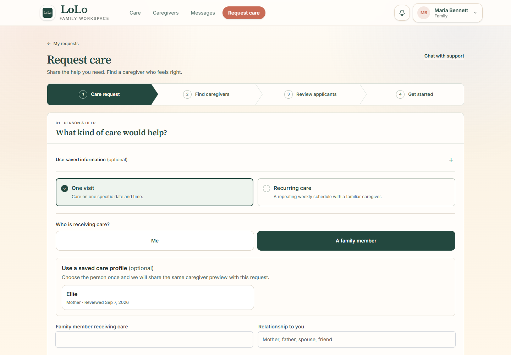
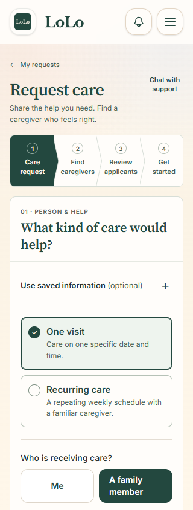

# Request creation: one-column layout

Local page: http://127.0.0.1:8028/family/requests/create

Updated September 10, 2026.

Later follow-up: [the large review section has now been replaced with a compact publishing footer](compact-footer/README.md). The captures below preserve the initial single-column version.

- Removed the right sidebar. Review and publish now follows Location & notes in the same full-width form.
- Removed the Person & help / Schedule / Location & notes / Review & publish section navigation.
- Connected the four recruitment stages with arrow shapes in the existing evergreen and cream colors. Care request remains the active stage. Future stages remain informational until the request exists.
- Kept estimates, fee breakdown, recurring schedule details, readiness checks, Edit links, privacy settings, validation errors, and publish/loading controls.

Verification: frontend build passed; five existing creation/publishing tests passed with 35 assertions. All 30 form bindings, seven action bindings, and 34 field-error directives match the previous view. The review partial is unchanged. Both one-time and recurring creation pages passed browser checks at 1440px, 390px, and 320px, with 12 top/full-page captures. Desktop, recurring mobile, and narrow mobile screenshots were visually inspected. Browser checks confirmed one column, review below the fields, arrow stages, preserved controls, and no horizontal overflow. All 26 care-data tables remain unchanged. See [browser results](validation.json).

## Preview

Earlier audit captures remain in their original dated folders.
