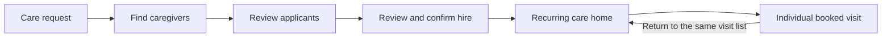

# Recruitment UI refinement · September 9, 2026

This local revision uses the supplied Upwork reference for the recruitment structure while retaining LoLo’s evergreen palette, cream surfaces, Inter body text, and Source Serif headings.

## What changed

The request now has four visible stages: **Care request → Find caregivers → Review applicants → Get started**. These stages describe the family’s decisions; the existing request, application, booking, payment, and recurring-plan statuses continue to control the business workflow.

- **Create request:** a connected hiring journey with Person & help, Schedule, Location & notes, and Review & publish anchors. The form keeps all existing inputs, validation, saved-information and care-profile flows. Selection states, the review summary, and the fee breakdown have a quieter, consistent treatment.
- **Care request:** a compact summary with recipient, dated schedule, location, visibility, tasks, care instructions, and the next action. Full care details and the requested recurring pattern remain accessible. On mobile, the next action appears before the longer request facts.
- **Find caregivers:** a full page with Search, Invited, and Saved profiles. Candidate rows put identity, experience signals, pricing, profile access, and the invitation action in predictable positions. Matching explanations remain available in a disclosure. Certification controls and guidance about schedule overlap live under Filters.
- **Existing invitation links:** the older private-request invitation entry point remains supported, with a single-column caregiver list inside the same styled dialog. Closing a dialog returns keyboard focus to its initiating control, or the current recruitment stage when the dialog opened directly from a link.
- **Review applicants:** comparable rows, All / Shortlisted / Past lists, persistent filtering and sorting, full application notes, profile details, chat, and an explicit hire action. “Shortlisted” belongs to this request; “Saved profiles” belongs to the family’s browsing history.
- **Get started:** a review of the selected caregiver, care instructions, full schedule, location, hourly care price, processing fee, and scheduled-visit total before the existing confirmation action.
- **Recurring care:** hiring leads into the existing recurring-care home. The arrangement holds the caregiver and ongoing schedule; each booked visit retains its own hours, updates, payment, review, and support history.

## Information and behavior retained

| Information or action | Where it is now |
| --- | --- |
| Recipient, schedule, address, privacy, tasks, care instructions | Request summary; full Care details |
| Requested recurring days, times, start/end dates | Summary and requested Weekly visits |
| Previous caregivers, saved profiles, recommendations, search | Find caregivers |
| Invitations, messages, sent/replied dates, current and historical status | Find caregivers → Invited |
| Certification filters and verification distinctions | Filters in discovery and applicant review |
| Matching score, proximity, reasons | Candidate → Why suggested |
| Ratings, review counts, verification and experience signals | Candidate row |
| Application status, note, recorded proposed rate, biography, skills, languages | Applicant row and Profile details |
| Shortlist, chat, reject, profile, hire | Applicant actions and More options |
| Reconsidering a rejected, withdrawn, or not-selected application | Past → Reconsider & hire, using the existing hire path |
| Existing visit, payment, cancellation, support and review actions | Existing booked-visit tabs |
| Recurring arrangement and individual-visit relationship | Recurring-care home and visit return links |

An **Application note** is not labeled as a message written by the caregiver: an accepted invitation can carry the family’s original invitation text. A schedule match means overlap, not a confirmed or conflict-free booking. No Upwork-specific quotas, earnings statistics, availability promises, or unsupported metrics were added.

## Pricing accuracy

Candidate prices, rate sorting, and the hire estimate use the same family–caregiver pricing agreement that applies to hiring. An already-booked caregiver uses the booking’s saved pricing snapshot. The family processing fee is displayed separately from the care amount; internal platform margin is not presented as a customer fee.

The estimate quotes the actual scheduled minutes rather than multiplying a rounded displayed rate. Existing legacy pricing continues through its existing rate and fee helpers. Viewing an estimate does not create a pricing agreement, booking, contract, payment, or invitation.

The recurring navigation follows this structure:

The request describes the proposed care. After hiring, the arrangement is the continuing home; the individual visit is the place for that date’s work and payment. Returning from a visit retains the arrangement’s visit filter and list context.

## Local data and compatibility

The preview remains at http://127.0.0.1:8028/login. Existing accounts and their passwords are unchanged.

| Local role | Email | Password |
| --- | --- | --- |
| Family | maria.find-care-audit@example.com | password |
| Caregiver | sofia.find-care-audit@example.com | password |
| Admin | admin.find-care-audit@example.com | password |

The existing September 9 pricing migration was applied to the isolated local audit database after a verified backup. It added the pricing-agreement table and nullable booking/payment fields. There was no reset, reseed, or fixture-date rewrite. QA compares all original columns and rows in the 26 care tables with its pre-work baseline.

The September 7 and September 8 screenshot packages remain separate historical records. This folder contains fresh screenshots, a screen tracker, visible-information inventories, interaction checks, and migration/data-preservation evidence for this revision. The full operational-lifecycle audit from September 8 remains available for the later visit stages.

## Review limits

This is a working local implementation, not a production deployment. Automated regression tests and rendered desktop/mobile checks cover the changed flows; the screenshots use local audit accounts and illustrative fixture data. Payment, messaging, invitation, and hire mutations are exercised in isolated automated tests, not against the browsed audit records.

See the generated tracker and validation report in this folder for the final screenshot inventory, widths, checks, and preservation results.

The final focused regression run passed **70 tests with 627 assertions** across CareWorkspaceNavigationTest, CaregiverInvitationExperienceTest, CareRequestFlowTest, and CareRecruitmentPolishTest. The new file contains 14 scenarios. Seven existing test methods received only the assertions needed for the intentional label/navigation changes; the existing same-day scheduling test and its provider remain unchanged and pass.

[Regression test output](regression-tests.log) · [Existing-test preservation evidence](test-preservation.json)

The Vite production build passed. The existing font-at-build-time and large-bundle warnings remain; browser QA separately verifies that the local fonts load in the rendered application.

A separate real-keyboard check verifies the stage bar at 320px: both the active green stage and inactive white stage retain a complete inset focus ring. The final CSS change affects keyboard focus only, so normal-state screenshots retain their recorded build provenance. [Keyboard-focus evidence](evidence/phase-focus-validation.json)
