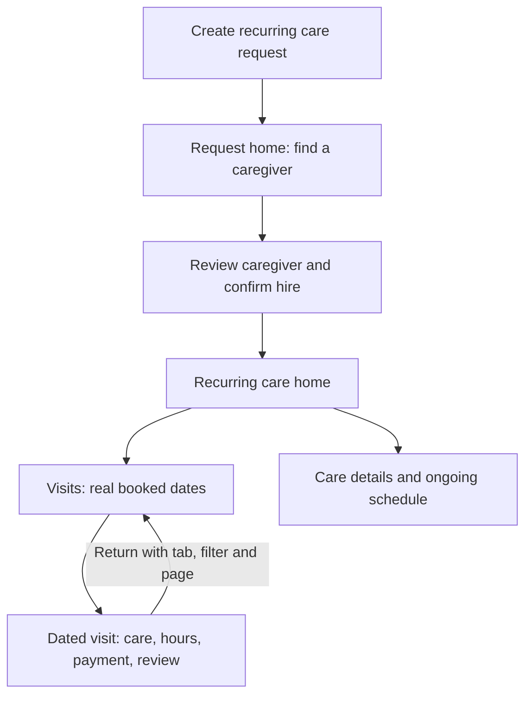

# Local care workspace implementation

Implemented September 8, 2026. The family find-care journey now uses the application's real Livewire screens and existing business actions. The primary redesign covers creation, recruiting, recurring-care management and individual visits through closure. Caregiver and administrator accounts are provided for local workflow exploration; their wider applications have not been comprehensively redesigned.

Open the [local application](http://127.0.0.1:8028/login), the [screenshot gallery](http://127.0.0.1:8031/), or the [master tracking file](master-tracker.md). [Local access and restart instructions](local-access.md) contain all sample accounts. [Final delivery validation](delivery-validation.md) confirms complete baseline coverage, current screenshots and source-refresh evidence, preserved data, working role accounts and gallery filters/links.

## What changed and why

| Area | Implemented experience | Reason |
|---|---|---|
| Create care | Four linked sections: Person & help, Schedule, Location & notes, Review & publish. Desktop has a review column; mobile keeps the same fields in a single stack. | The person can check recipient, schedule, address, tasks, visibility and price before publishing. All original fields, validations and saved-detail reuse remain. |
| Waiting and recruiting | One Overview with the current next action; one consistent Caregivers list for zero, one or many replies. Existing replies appear before invitation tools, with a compact Invite someone link. | The navigation no longer changes shape when one person applies. Candidate cards are easier to reach, and a filtered empty result does not hide the filters needed to recover. |
| Recurring care before hire | Overview, Caregivers, Visits and Care details. Visits explains the requested weekly pattern and that it is not booked yet. | Publishing a request is distinct from having confirmed visits. The UI does not invent a plan or booking before the existing hire service creates it. |
| Ongoing recurring care | A stable care home with Overview, Caregivers, Visits and Care details. Overview shows current/next care and outstanding decisions. | Families can manage the arrangement without treating each visit as a new job posting. |
| Individual recurring visit | A dated page with This visit, Care instructions and Help & changes, plus a clear return to the parent care. | Hours, changes, payment and reviews belong to that occurrence. The parent is always reachable. |
| Hours and hiring | Review the caregiver or hours/payment details in an inline panel, then explicitly confirm. Back or changing tabs closes the preview while keeping drafts. | Consequential decisions become reviewable. The confirmation still calls the existing business method. |
| During care | Compact safety/access/contact essentials plus the task record and activity. Full attached care instructions remain one tab away. | The information needed during a visit remains visible after moving the full profile out of every page header. |
| Help | Contextual Help and an inline Chat with support entry. | The floating launcher no longer covers mobile actions inside the redesigned workspace. Existing support forms and chat remain available. |
| Visual design | LoLo evergreen and cream, clearer text contrast, local Inter/Source Serif 4 fonts, explicit hover/focus/disabled states and responsive layouts. | The workspace follows the existing brand and provides readable, distinguishable controls. |

The design borrows the useful principle of a stable work home with a clear next action. The implementation retains care-specific safety, timekeeping, approval and recurring-schedule requirements.

## The recurring navigation model

Before hire, the weekly pattern is a request. After the existing activation service creates the plan and bookings, successful recurring hire normally opens the recurring-care home. If the first payment still requires card authentication, the family stays on that exact first visit so the existing secure confirmation can finish.

The recurring-care title uses the recipient's full name consistently. Each visit reads its own assigned caregiver and address. A later generated request may still be stored as a one-time record with a care-plan association; that legacy representation is retained.

Visits has Upcoming, Needs follow-up, Past, Cancelled and All filters with pagination. Needs follow-up includes outstanding decisions across dates rather than only the next twelve visits. Unresolved extra-visit reports appear before resolved ones and are not hidden behind the previous twelve-report display cap. Ending the arrangement does not hide an existing visit retained by the service.

Returning from a dated visit restores the selected parent tab, visit filter and pagination page, and targets that visit's row. Direct links from notifications, history and schedules continue to open the exact occurrence.

## Try the implemented journey

Sign in as the family first. These are existing synthetic fixture records; dates and independent statuses intentionally show different lifecycle stages.

| Experience | Local page |
|---|---|
| Create one-time or recurring care | [Create care](http://127.0.0.1:8028/family/requests/create) |
| Recurring request before hiring | [Request Overview](http://127.0.0.1:8028/family/requests/13?tab=home) and [requested Visits](http://127.0.0.1:8028/family/requests/13?tab=visits) |
| Compare multiple caregivers | [Caregivers](http://127.0.0.1:8028/family/requests/34?tab=applicants) |
| Private request | [By-invitation request](http://127.0.0.1:8028/family/requests/35?tab=home) |
| Active recurring care | [Care home](http://127.0.0.1:8028/family/care/1?tab=overview) and [Visits](http://127.0.0.1:8028/family/care/1?tab=visits) |
| Scheduled recurring visit | [Exact visit](http://127.0.0.1:8028/family/requests/16?tab=shift) |
| During a recurring visit | [Live visit](http://127.0.0.1:8028/family/requests/17?tab=shift) |
| Review submitted hours | [One-time hours](http://127.0.0.1:8028/family/requests/8?tab=shift) and [recurring hours](http://127.0.0.1:8028/family/requests/19?tab=shift) |
| Payment needs attention | [Exact affected visit](http://127.0.0.1:8028/family/requests/37?tab=shift) |
| Time correction | [Existing correction flow](http://127.0.0.1:8028/family/requests/38?tab=shift) |
| Leave a review | [Recurring visit review](http://127.0.0.1:8028/family/requests/20?tab=shift) |
| Closed visit and ended care | [Closed visit](http://127.0.0.1:8028/family/requests/21?tab=shift) and [ended care](http://127.0.0.1:8028/family/care/4?tab=overview) |
| Other offer states | [Pending](http://127.0.0.1:8028/family/care/2), [counterproposal](http://127.0.0.1:8028/family/care/8), [declined](http://127.0.0.1:8028/family/care/9), [cancelled](http://127.0.0.1:8028/family/care/10) |
| Cross-care navigation | [My care](http://127.0.0.1:8028/family/requests), [arrangements](http://127.0.0.1:8028/family/care), [Schedule](http://127.0.0.1:8028/family/care/schedule), [History](http://127.0.0.1:8028/family/care/history) |

Opening review panels is read-only. Confirming their final buttons performs the existing action against this isolated local database. Sample records can therefore change as you explore them; restarting does not reset your interactions.

## Backward compatibility and data preservation

No application schema migration or business-record conversion was introduced. Existing hiring, matching, invitation, eligibility, authorization, payment, cancellation, approval, correction, review and profile-sharing services remain the authority. Presentation classes, views and navigation were changed; final action wrappers delegate to existing methods.

| Existing entry point | Current destination |
|---|---|
| Request URL without an explicit tab | Current lifecycle Overview; unbooked requests, including overdue ones, use `home`. |
| `/family/requests/{id}?tab=overview` | Care details, or Care instructions for a recurring visit. This legacy key retains its existing meaning. |
| `?tab=applicants` | Caregivers/recruitment history, including explicit legacy links on a booked recurring request. |
| `?tab=shift` | The exact booking's Overview / This visit. |
| `?tab=support` | The exact request/visit's Help and changes. |
| `/family/care/{plan}` | Stable recurring-care home; tab keys are `overview`, `caregivers`, `visits`, `details`. |
| Parent return context | Validated `return_tab`, `visit_filter`, `return_page`; restored as parent tab/filter/`visitsPage` plus the booking anchor. |
| Existing Care story, History and Book again routes | Retained with their existing record identity and business behavior. |

Request, plan, booking, submitted hours, approval, correction, payment/refund and review states remain separate. A completed visit does not mean its payment settled; leaving a review does not close an ongoing plan. The after-shift and timesheet fixtures can share a submitted-but-unconfirmed backend state without a fabricated new status.

Attached care-profile versions remain the source for booked care. The UI does not substitute today's editable profile for a historical snapshot. Dated visits use their actual caregiver and address, even when these differ from the recurring arrangement.

The schedule-management copy reflects existing consequences. In particular, accepting a future schedule change cancels future scheduled plan bookings from its effective date, including extra visits, before generating the replacement regular schedule. Ending a plan shows the next booking kept by the existing default. These policies were not silently changed.

The [implementation preservation map](implementation-preservation-map.md) traces all 31 original information/action families and the independent-state contract to their destinations. Full plan event payloads remain stored in the database; neither the original nor new plan Details renders a complete event log.

## Screenshot and information inventory

The completed capture matrix contains **319 screen states: all 175 original state IDs plus 144 added states** for the new navigation, plan tabs, filtered lists, expanded details, decision reviews and inline support. It contains **638 desktop/mobile views and 1,914 PNG screenshots**. Every state has both a 1440 × 1000 desktop viewport and a 390 × 844 mobile viewport, with a viewport image, focused image, full-page image, visible text and control/field inventory. The original September 7 screenshots remain the comparison baseline. The six role-login views are additional access evidence and are not included in these lifecycle totals.

Use the gallery filters to choose care variation, lifecycle stage and screen. Each state links to its full information inventory, including the selected tab, visible actions, inputs, links, status and exact fixture identity. Each entry also explains the implemented layout decision; this rationale is distinct from its automated capture validation and representative visual review. An expanded disclosure or review panel is a separate capture state; offscreen full-page content is distinguished from the initial viewport.

Completion and evidence files:

- [Master tracker](master-tracker.md), [capture manifest](captures.json), [capture method](method-and-coverage.md).
- [Baseline coverage](baseline-coverage.json), [capture validation](validation.json), [screen semantics](screen-semantics.json).
- [Fixture states](fixture-semantics.json), [stored-data preservation](data-preservation.json).
- [Role access checks](role-smoke.md) and [role results](role-smoke.json).

## Validation

The selected application suites passed **224 tests and 1,687 assertions** across creation/hiring, payments, privacy, invitations, family navigation, guided assistance, recurring plans, time corrections and the new workspace contracts. The [application test summary](validation/application-tests-summary.md) lists the disjoint selections and evidence. The [compatibility report](validation/compatibility-summary.md) explains the six intentional UI-test migrations and proves the pre-existing user test additions were preserved.

The browser interaction check passed 120 checks at widths 1440, 390 and 320: representative pages render without horizontal overflow, primary text retains contrast in normal/hover/focus states, keyboard focus is visible, approval drafts survive back/reopen, the confirmation button is unobscured, inline support opens and the actual brand fonts load. See [browser interaction results](workspace-ui-validation.json). This is targeted coverage, not a claim of a complete accessibility audit.

The production frontend build passed. Fonts are served locally so the care workspace keeps its brand without a Google Fonts request. Font source/license details are retained in [public/fonts/README.md](../../../public/fonts/README.md). The existing large image-conversion bundle warning remains a build optimization item.

## Local environment and limits

The demo uses `.tmp/find-care-screen-audit-2026-09-08/find-care-audit.sqlite`. The project's `.env`, default database and original audit database are unchanged. A read-only comparison verifies **685 original rows across 61 related tables**, including profiles and their versions, tasks, events, messages and identity fields. The original audit database hash is unchanged. Operational auth/login fields, read receipts, session/cache/activity telemetry and unrelated runtime tables are explicitly excluded in the data report. Additional sample records exercise the new UI states.

Payment and identity/SMS integrations use the existing local bypass settings; mail uses the array transport, and external AI is disabled. No real payment, delivered communication, map provider, device-location permission or card-authentication challenge is claimed as end-to-end verified. Screenshots intentionally block external provider content and use real local app data. No clock-driven queue worker was started to advance fixture lifecycles while capturing.

The matrix is exhaustive for the named audited screen states, not every possible combination of financial, scheduling, profile or provider values. Direct recurring-offer/repeat composers retain their existing editors; they are not represented as fully standardized new creation flows. The broader caregiver and admin UI is access-smoke-tested only.

Everything is local and uncommitted. Restart instructions and credentials are in [local access](local-access.md).
