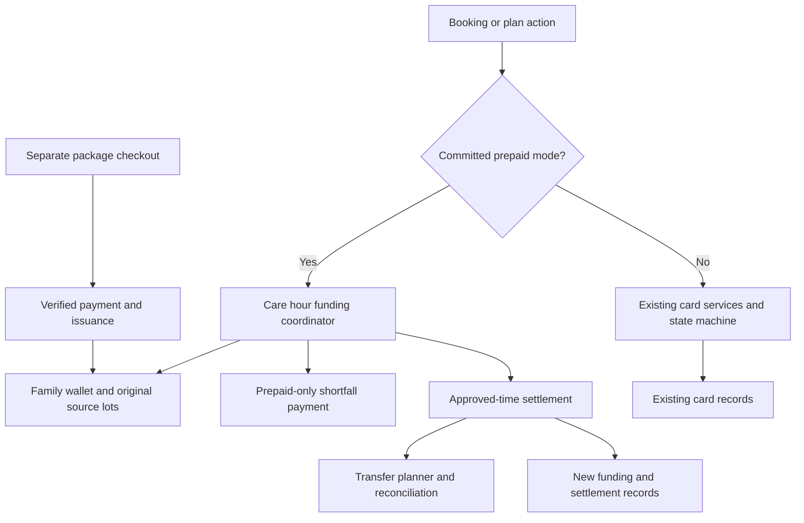

# Prepaid care hours implementation plan

Status updated October 30, 2026: the shared family-wallet change is prepared locally and has not been deployed or verified in production. It uses one owner-managed wallet per stable family account, with no purchase/claim recipient chooser. The current pilot remains only Thibaud Peverelli's signed-in family account, `peverelli.t@gmail.com`; ordinary card behavior is unchanged. Safe delivery requires a v1 bridge release followed by the v2 wallet release, with the usual `./deploy.sh` for each and no manual environment edit to enable the approved pilot. Do not describe v2 as deployable in one invocation of the currently installed v1-only driver.

`CARE_HOURS_PRIVATE_PILOT_ENABLED=false` remains the persistent pause. The assistant has not accessed the production server, deployed or run production migrations, and is prohibited from SSH/server access. The [deployment runbook](../deployment/zero-downtime-deployments.md#family-wallet-contract-v2) defines packaging, floor and cache checks. Current terms version: `2026-10-30-family-wallet`.

Earlier test counts and recipient/self-profile behavior in the dated evidence at the end describe historical revisions, not proof of this family-wallet release.

### October 30 family-wallet validation

Local validation covers 399 current prepaid tests and 493 existing card, booking and regular-care regression tests. Final reruns supersede the earlier failing recipient-specific expectations. Coverage includes preserved historical purchase/allocation IDs, pooled balances, once-per-family welcome offers, ownership transfer, foreign-family rejection, pilot access, and explicit card choices retained across recipient changes and old open-page hydration.

The MySQL rehearsal preserves existing card rows and verifies concurrent purchases, pooled reservations, duplicate gift claims and cancellation versus failed-payment callbacks. Both forced callback orders restored the original source ranges once with no deadlock. Browser checks verified desktop/mobile purchase and new-account gift claim journeys without JavaScript errors or external payment/email calls. The local screenshots and consolidated evidence are in `output/prepaid-family-wallet/`.

Deployment checks passed the actual old-driver bridge scenario, permanent v2 rollback floor, atomic deployment smoke, 207 cached-configuration checks and final v2 manifest verification. The manifest generator rejects a family-wallet tree labelled as v1. These are local tests; they neither deploy the bridge nor authorize production access. Real email delivery remains deferred as requested.

## 1 Outcome and compatibility requirement

Implement prepaid care hours as an additive funding option. As confirmed on October 26, eligible available hours are selected by default for any eligible recipient in the family on a new request, hire or recurring offer, including a newly added person. The family may choose card instead, and that choice persists through recipient changes, posting and reloads. Families can buy into their shared wallet without choosing a recipient, outside contributors can use a family link, and confirmed bookings can redeem those hours. Existing credit-card booking and payment behavior must remain unchanged.

The implementation preserves the current card path when the family chooses card or has no eligible hours. Buying a package must not change a saved card, convert a booking, release an authorization, refund a visit, change an existing recurring plan, or provide an automatic fallback for a failed card payment. A new request saves its selection in `care_hour_request_preferences` without reserving minutes or preparing payment. The family reviews funding at booking; prepared card visits retain their original funding.

Use new prepaid services and records behind a small funding-mode dispatcher. A booking without a committed prepaid mode follows its existing card code. A draft screen choice or quote is not a funding-mode commitment. A prepaid booking continues through its recorded funding path during settlement and recovery, even after new purchases or new feature enrollment are disabled. Existing unused entitlements must remain redeemable. The compatibility target is unchanged behavior, not a claim that no existing integration file will need a small dispatch hook.

Do not bundle a rewrite of the card-payment state machine, a global Stripe SDK/API upgrade, a Connect account migration, unrelated payment fixes, or mandatory historical data conversion into this feature. If a provider prerequisite requires one of those changes, stop that implementation phase and handle the prerequisite separately before enabling prepaid sales.

### Compatibility acceptance matrix

| Situation | Required behavior |
| --- | --- |
| No eligible balance | Existing card screens, validation, processor calls, amounts, buffers, timing, statuses and notifications behave as before |
| Eligible positive balance on a new request | Preselect family hours for any eligible care recipient; show any uncovered estimate; no reservation at posting |
| Family has a positive balance but selects card | Charge through the existing card path; no minute reservation or usage |
| Package purchased while card bookings or plans exist | Do not alter their payment methods, authorizations, charges or prepared visits |
| Existing card payment fails | Use existing recovery; do not silently spend hours |
| Explicit prepaid selection | Use the new preparation, readiness and settlement services |
| Existing plan adopts prepaid for future visits | Apply only to future visits without prepared funding; preserve already funded card visits |
| New enrollment or sales disabled later | Existing unused hours remain redeemable; prepaid reservations, usage, cancellations, statements and recovery keep working |
| Draft prepaid choice abandoned | No committed mode change; the booking retains its original card path |

## 2 Product rules carried into the build

| Paid hours | Price in USD | First qualifying purchase bonus | Total minutes when eligible |
| --- | ---: | ---: | ---: |
| 5 | $155 | None | 300 |
| 10 | $310 | 1 hour | 660 |
| 20 | $620 | 2 hours | 1,320 |
| 40 | $1,240 | 4 hours | 2,640 |

The welcome bonus is automatic, needs no code, and is the only launch promotion. Eligibility belongs to the stable family account and is consumed once by the first successful 10-, 20-, or 40-hour purchase, regardless of payer. Five-hour purchases neither award a bonus nor consume eligibility. Separate five-hour purchases do not combine into a qualifying package.

Paid and bonus hours share booking rules, no expiry, included hourly family fees, and protection against later standard price increases. Valid package purchases are non-refundable. Undelivered cancellations and no-shows return all reserved minutes, with no fee. One owner-managed family wallet covers eligible care for all family recipients. Buy and claim require no recipient profile; transfers between family accounts are unsupported. Previously awarded hours and accepted quotes remain intact. A prior family award prevents another welcome award.

Within explicitly selected prepaid mode, reserve planned minutes without an extra buffer. Full coverage requires no saved card. Shortfalls use a separately authorized one-off payment or an optional saved family card, or the family can buy another package. Never save a card without consent or reuse a donor's card. Approved unavoidable overruns preserve actual time and create a separate amount due; they do not stop care automatically or make the hour balance negative.

LoLo fronts each purchase's actual processing fee. Recover it proportionally from caregiver earnings as care is completed and approved, using all original paid-plus-bonus minutes. Caregiver gross follows the visit agreement. A promotion or later rate increase must not reduce gross compensation or create a family surcharge on covered minutes.

## 3 Current implementation and integration boundaries

The repository uses Laravel 12, Livewire 3, PHP 8.2 or later, PHPUnit and Playwright. The installed Stripe PHP version in the lockfile is 16.5.0. Existing test defaults use SQLite and Stripe bypass mode; those tests alone cannot prove production lock behavior or provider compatibility. See [composer.json](/C:/Users/Epicpp/homecare/composer.json), [composer.lock](/C:/Users/Epicpp/homecare/composer.lock:3668), [phpunit.xml](/C:/Users/Epicpp/homecare/phpunit.xml) and [Playwright configuration](/C:/Users/Epicpp/homecare/playwright.config.ts).

| Area | Existing integration point | Plan |
| --- | --- | --- |
| Family wallet ownership | [CareHourAccount](/C:/Users/Epicpp/homecare/app/Models/CareHourAccount.php), [family wallet mapping](/C:/Users/Epicpp/homecare/database/migrations/2026_10_30_000100_create_care_hour_family_wallets.php) | Use stable family ownership for credit; retain existing recipient/profile behavior only for normal care setup |
| Family access | [FamilyAccountContext](/C:/Users/Epicpp/homecare/app/Services/FamilyAccounts/FamilyAccountContext.php:16), [account model concern](/C:/Users/Epicpp/homecare/app/Models/Concerns/BelongsToFamilyAccount.php:33) | Preserve existing membership; validate contribution targets separately from the payer's account |
| Family card setup | [FamilyBillingService](/C:/Users/Epicpp/homecare/app/Services/Payments/FamilyBillingService.php:22) | Keep setup and saved-card behavior; add a distinct package purchase checkout |
| One-time hiring | [ManageCareRequest](/C:/Users/Epicpp/homecare/app/Livewire/Family/ManageCareRequest.php:535), [CareRequestHiringService](/C:/Users/Epicpp/homecare/app/Services/Marketplace/CareRequestHiringService.php:66) | Add a guarded dispatch only after explicit prepaid selection |
| Regular care | [CarePlanService](/C:/Users/Epicpp/homecare/app/Services/RegularCare/CarePlanService.php:183), [payment window](/C:/Users/Epicpp/homecare/app/Services/RegularCare/CarePlanPaymentWindowService.php:20) | Separate prepaid preparation while preserving card-plan queries and behavior |
| Check-in | [CareBookingCheckInPolicy](/C:/Users/Epicpp/homecare/app/Services/RegularCare/CareBookingCheckInPolicy.php:14) | Add prepaid-only coverage checks; retain card-mode rules, including its current one-time behavior |
| Approval and capture | [BookingPaymentService](/C:/Users/Epicpp/homecare/app/Services/Payments/BookingPaymentService.php:651), [AutoApproveTimesheets](/C:/Users/Epicpp/homecare/app/Console/Commands/AutoApproveTimesheets.php:23) | Dispatch prepaid bookings to a separate settlement path; do not change legacy capture |
| Payment accounting | [BookingPaymentV2Service](/C:/Users/Epicpp/homecare/app/Services/Payments/BookingPaymentV2Service.php:165), [operation ledger migration](/C:/Users/Epicpp/homecare/database/migrations/2026_08_26_000001_add_marketplace_pricing_v2_ledger.php:49) | Keep booking charge records truthful; create package and allocation records separately |
| Webhooks | [StripeWebhookController](/C:/Users/Epicpp/homecare/app/Http/Controllers/StripeWebhookController.php:84) | Route positively identified prepaid objects to new handlers; all existing objects retain their current handlers |
| Corrections | [BookingCorrectionService](/C:/Users/Epicpp/homecare/app/Services/Booking/BookingCorrectionService.php:451), [CareBookingTimeCorrectionService](/C:/Users/Epicpp/homecare/app/Services/Booking/CareBookingTimeCorrectionService.php:592) | Prepaid-only previews and execution using minute and cash deltas; retain current card calculations |
| Recovery holds | [PrepaidVisitPaymentGuard](/C:/Users/Epicpp/homecare/app/Services/Payments/PrepaidVisitPaymentGuard.php:10) | Preserve this unrelated existing recovery workflow; do not reuse its flags for packages |

Existing visit finalization expects a successful booking charge and derives transfers from that charge. A fully prepaid visit cannot be implemented by marking a fake card transaction successful or copying one package charge into every visit. The new domain must distinguish the purchase payment, the care entitlement, the visit's funding, and the caregiver settlement.

## 4 Proposed architecture

Names below are proposed implementation names. They describe responsibilities and boundaries, not existing classes or a required database layout.



### Service boundaries

- **CareHourIdentityService:** create/reuse the canonical wallet under the family lock, group same-family source accounts, preserve historical associations and enforce family ownership without creating care profiles.
- **CareHourCatalogService:** version prices and terms; generate server-priced quotes and the automatic welcome eligibility result.
- **CareHourPurchaseService:** accept the quote, own payment attempts, fulfill once, and recover uncertain outcomes.
- **CareHourLedgerService:** issue, reserve, consume, restore and hold integer minutes with immutable history and conservation checks.
- **CareHourContributionService:** owner-managed private links, guest email verification and buyer-only receipt access.
- **CareHourGiftService:** verified guest purchase without a selected recipient, private code recovery, family-scoped review and atomic claim of the original paid purchase.
- **PrepaidBookingFundingService:** prepare opted-in visits, determine coverage, manage provisional reservations and shortfall payment operations.
- **PrepaidBookingSettlementService:** settle approved care, allocated purchase fees, gross/net earnings and uncovered amounts due.
- **PrepaidTransferPlanner:** calculate and execute remaining transfers across purchase/card/platform sources without duplicating payouts.
- **PrepaidReconciliationService:** replay unresolved work, compare balances and operations, and expose actionable recovery cases.

The dispatcher must select by an atomically committed prepaid mode, not by a draft quote, a positive balance, a saved-card flag, a payment failure, or the current sales feature flag. Keep new provider orchestration outside existing card services. Reuse a low-level helper only after tests establish that it has no booking-specific assumptions or side effects.

Keep new reconciliation/notification workloads from delaying existing card jobs: use bounded dedicated queue capacity and avoid adding full-ledger scans to card request paths. Failure of a new package report, checkout or background job must not block ordinary card checkout. Measure card-path latency and job backlog against the baseline during rollout.

### Logical data records

Use additive tables and optional sidecar associations. Do not make existing booking/request/profile columns mandatory or backfill all families to launch. The additive `2026_10_30_000100_create_care_hour_family_wallets.php` migration maps stable family IDs to canonical accounts. Existing financial foreign keys and source history are not rewritten.

| Record | Essential data | Integrity requirement |
| --- | --- | --- |
| Family wallet mapping | Stable `family_account_id`, canonical `care_hour_account_id` | One mapping per family; owner/member changes preserve ownership |
| Historical source association | Existing care-hour accounts and their family/currency | Retain original recipient/profile references and all audit rows; group only same-family/currency sources |
| Care hour account | Family, currency, source state, balance projection version | One logical family wallet with retained source accounts; projections reconcile to the original ledger |
| Catalog and offer version | Package hours, price cents, bonus minutes, terms version, activation state | Existing quotes and purchases keep immutable snapshots |
| Purchase | Buyer attribution, target family/source account, paid/bonus minutes, total issued, exact cents, terms and quote | Immutable target after payment; payment and issuance states tracked separately |
| Purchase attempt | Accepted quote revision, provider IDs, idempotency identity, status, timestamps | At most one economic charge per accepted attempt; unknown is not failed |
| Welcome claim | Family scope across all historical sources, lifetime offer key, owning attempt/purchase, state | Serialize under family lock; any prior valid award or accepted pending claim blocks a competing award; never remove past awarded hours |
| Purchase lot and minute ledger | Original minute ranges, category, issue/reserve/use/restore/hold/reverse entries | Integer-minute conservation and immutable audit history |
| Booking prepaid funding | Booking, family/source account, committed selection, funding revision, readiness and shortfall | Unique active booking association; no committed prepaid mode means existing card flow; drafts remain separate |
| Plan prepaid preference | Plan, explicit actor/consent, effective future selection | Applies only to unfunded future visits; no rewrite of prepared visits |
| Reservation allocation | Booking funding revision, purchase lot, exact original minute ranges, lifecycle state | No minute reserved twice; original allocations retained for restoration |
| Financial operations and fee revisions | Purchase/shortfall charge, balance transaction, actual fee, refund/dispute/adjustment IDs | Provider object ownership unique; no duplication into visit card ledgers |
| Settlement and transfer operations | Approved-time revision, allocation references, gross, fee shares, net, source links, transfer/reversal states | Idempotent revision; partial success cannot be shown as fully paid |
| Contribution link and verification | Target family, hashed tokens, fixed **Family care balance** label (historical links retain their approved label snapshot), revocation, verified buyer session | Link grants purchasing only; separate receipt access, no family membership |
| Outbox and recovery case | Domain operation, notification/recovery payload, delivery status | After-commit side effects; safe replay and no duplicate receipts |

Keep immutable `buyer_user_id` or verified buyer email separate from family ownership fields. The existing family-account model concern derives account ownership from the authenticated actor; using it unmodified for a donor signed into another family can assign the wrong target account. Ownership-transfer code also rewrites some legacy owner IDs. New purchase attribution must remain historically accurate through either operation.

Do not cascade-delete financial records when a user leaves, a link is revoked, or a recipient/profile is archived. Public views must use explicit allowlisted data, not serialize a family, member or recipient model.

### Minute and fee accounting

For each lot, original issued minutes equal available + reserved + used + held + reversed minutes. These categories are mutually exclusive. Cached balances must be reproducible from the ledger. No available balance may become negative.

Use oldest purchase lots first. Within a lot, use original ordinal ranges, with paid minutes before bonus minutes as an internal deterministic default. This ordering changes neither care coverage nor the fee rate and requires no family choice. Save exact ranges so later corrections restore the same entitlements.

For `M` originally issued minutes and `F` actual processing-fee cents, define the prefix fee at minute `k` as `floor(F × k ÷ M)`. A range from `a` to `b` carries `prefix(b) − prefix(a)` cents. This spreads rounding deterministically across original minutes, allocates exactly `F` at full redemption, and is independent of caregiver settlement order. Use integer arithmetic with a sufficiently wide intermediate value.

Keep `M` unchanged after corrections or reversals. A processor fee revision calculates a new target for the same ranges and posts only the signed delta. Reverse the recorded fee allocation when restoring used minutes. Track any already-paid earnings adjustment explicitly; never silently rewrite a completed transfer or shift unused-minute fees to another caregiver.

Example: 10 paid hours + 1 free hour gives 660 minutes. With a hypothetical actual fee of $11, a 120-minute allocation carries $2. At $27 gross per hour, two hours produce $54 gross and $52 after that fee deduction. This is an arithmetic example, not a quoted processing rate.

## 5 State and operation contracts

### Package purchase

1. Resolve the stable family wallet and buyer permissions; generate a price/terms snapshot on the server.
2. Reserve welcome eligibility only for an eligible 10-, 20-, or 40-hour quote. Five-hour attempts do not touch that claim.
3. Accept the quote and persist an attempt with a stable operation identity before a provider request.
4. Create the package payment checkout outside the database transaction. Reuse the attempt identity on network retry; a timeout leaves the result unknown.
5. On authoritative paid status, verify expected amount, currency, account/environment and local purchase identity.
6. In one short database transaction, issue paid and bonus minutes exactly once and consume the welcome claim. Queue receipt/family notification after commit.
7. Resolve failed and abandoned attempts only after confirming no accepted or pending payment can still succeed. Do not free an uncertain welcome claim solely because a local timer elapsed.

Separate payment success, entitlement issuance, fee availability and payout completion. A paid purchase can issue usable hours before its actual processing fee is available; later earnings can remain pending fee finalization without mislabeling the purchase as unpaid or charging the family again.

A later quote change requires the buyer to accept the changed hours/price before payment. No retroactive loss of an accepted bonus. Invalid or duplicate purchase recovery uses the spec's audited correction rules; a chargeback on consumed care never automatically earns a second welcome award.

### Prepaid booking funding

Keep draft quotes outside committed booking funding. Suggested preparation states after mode commitment: selected but unprepared, preparing, awaiting shortfall payment, ready, payment attention, released. Settlement states are separate: awaiting time approval, partially settled, settled, payout pending, paid, correction pending. Do not encode these states as fake card authorization/capture states.

Commit prepaid mode under the booking lock only while there is no existing prepared, pending, unknown or failed legacy card operation or payment attempt. A race with existing card preparation must have one winner: if card preparation already owns the booking, reject the switch and preserve the card flow; if prepaid commitment wins, legacy preparation must not authorize that booking. Recheck the committed mode before any legacy provider request that can race with selection. Never interpret a failed or unknown card attempt as an unfunded blank slate.

When creating an occurrence from an opted-in plan, create its committed prepaid association in the same transaction before scheduler or check-in preparation can observe it. Apply the same rule when adopting a future unprepared occurrence. Exclude every committed prepaid preparation state from the legacy card due-query, including selected-but-unprepared and payment-attention states. This exclusion affects only opted-in visits and does not change the existing card cohort's ordering or timing.

Reserve only planned eligible minutes. If fully covered, use an explicit zero-card path: do not pass zero uncovered minutes through existing pricing helpers that round up to a minimum charge/minute. If partly covered, quote only uncovered time and apply any applicable card authorization buffer only to that amount. No mandatory saved card and no donor payment-method reuse.

Persist mixed-funding reservations provisionally while the shortfall payment resolves. Confirmed failure releases provisional minutes; unknown outcomes remain recoverable. A failed shortfall cannot mark the visit ready. Keep already prepared card bookings outside this process.

### Concurrency and idempotency

- Use database uniqueness for purchase economic operations, welcome claims, booking funding associations and settlement revisions, in addition to webhook event deduplication.
- Publish one lock order for new prepaid operations: family row, same-family source accounts in stable order, then funding records, then purchase lots/ranges. Avoid entering the legacy booking-payment lock path and then acquiring wallet locks in the opposite order.
- Hold locks only for local validation and state changes. Persist provider work, commit, call the provider, then record/reconcile the result.
- Every issuance, reservation, settlement, correction and transfer has a stable operation key independent of its amount. Changed quotes create explicit revisions.
- Require a reconciled result before creating a replacement provider operation. Distinct success events for the same payment must still issue only once.
- Reserve provider source-charge capacity transactionally before each transfer request. Count successful, pending and unknown transfer commitments against the source limit; release unknown capacity only after reconciliation. A transfer reversal must not be assumed to restore provider capacity until the spike confirms its exact behavior.
- Notifications and follow-up work use an outbox or equivalent after-commit delivery. Browser return pages display status; they do not independently mint hours.

## 6 Payment provider design and validation

Use a separate package checkout flow, initially targeting Stripe-hosted Checkout for one-time purchases. Preserve the existing family setup checkout and its saved-card behavior. Store only internal opaque IDs in provider metadata, without recipient care details. Package checkout must show the exact approved USD amount, no promo-code field, and no forced saving of the payer's method.

Stripe documents separate charges and transfers for payments made before the eventual connected account is known and for payments funding multiple recipients. This matches the proposed package-to-many-caregivers relationship, but account compatibility and execution details still need validation against LoLo's existing integration. [Stripe charge types](https://docs.stripe.com/connect/charges), [separate charges and transfers](https://docs.stripe.com/connect/separate-charges-and-transfers).

Confirmed documented constraints to build around:

- Multiple transfers can reference a source charge, but their combined amount cannot exceed that source charge. A future increase in caregiver cost may therefore require a separately recorded platform-funded component.
- A transfer group associates objects; it does not reserve funds or replace an internal allocation ledger.
- Refunding a platform charge does not automatically reverse associated transfers. Refund/reversal recovery must be explicit.
- Available balance and payout scheduling matter for transfers without a source charge. An unsuccessful transfer needs application recovery; do not assume an automatic retry.

These constraints come from [Stripe's separate charge and transfer documentation](https://docs.stripe.com/connect/separate-charges-and-transfers) and its [payment acceptance guide](https://docs.stripe.com/connect/marketplace/tasks/accept-payment/separate-charges-and-transfers).

### Required provider spike before selling packages

Use isolated non-live testing; do not change the live account or current card integration during the spike. Record evidence for:

1. Package checkout using the existing pinned SDK/API combination, authoritative paid state, asynchronous success/failure and duplicate/out-of-order events. Any required upgrade is a separate compatibility prerequisite, not an automatic change to existing card traffic.
2. A one-off shortfall payment with no saved-card mandate, including authentication, failure and expiry; capture/release behavior must satisfy prepaid booking readiness.
3. One purchase paying several caregivers across several visits, a visit consuming multiple purchases, aggregate source-charge limits including concurrent/pending transfers, partial retries, and whether reversals restore source capacity.
4. Long-delayed redemption and how platform liquidity funds future transfers after normal bank payouts. No-expiry care entitlement lives in LoLo's records; do not assume an indefinite provider-held reserved balance or special funds-segregation feature.
5. Gross caregiver obligations exceeding remaining purchase proceeds after a future rate increase. Demonstrate an explicit platform-funded top-up path without charging the family or falsifying the original source-charge amount.
6. Actual fee retrieval, delayed financial details, fee revisions and negative/invalid calculated transfer cases. Route unresolved cases to payment attention instead of estimating final deductions or sending an invalid transfer.
7. Provider object ownership and event routing, connected-account payout readiness, idempotency retrieval and retry behavior.

Before choosing exact event subscriptions, validate them for the selected flow. The one-time Checkout acceptance guide requires handling completion and asynchronous outcome events; completion alone can precede payment success. Use verified paid status for issuance. [Stripe Checkout payment events](https://docs.stripe.com/connect/marketplace/tasks/accept-payment/separate-charges-and-transfers).

### Webhook compatibility

Preserve the current signature verification and durable webhook inbox. Add a narrow dispatch based on persisted ownership of package/shortfall/transfer objects. A validated local attempt may resolve an early webhook before the provider response has been stored. All other existing events retain their current handlers and response behavior.

Do not send package refunds/disputes through booking handlers, or package purchases through family card-setup handlers. Do not deploy two competing consumers that share one processed-event marker and can acknowledge an event before its owning domain handles it. Unknown dependencies stay retryable. Package handlers must continue for existing purchases when new sales are disabled.

## 7 Delivery phases and completion criteria

The phases below describe review boundaries for the locally prepared implementation. The existing private pilot audience remains unchanged. Family-wallet production delivery is separate and requires the bridge sequence in section 13; local implementation and testing do not establish production readiness.

### Phase 0 Compatibility baseline and design decisions

**Deliverables**

- Capture current card flows with existing regression fixtures: one-time booking, regular care, setup checkout, authentication/retry, capture, cancellation, corrections, payout and webhook replay.
- Document the committed funding discriminator and exact small dispatch sites. No committed prepaid mode means the existing card path; draft quotes cannot switch it.
- Complete the provider spike in section 6 and record any dependency requiring separate work.
- Select the database engine used for concurrency verification from actual deployment configuration; the checked-in default is not proof of production configuration.
- Resolve proposed data-record naming, lock order, fee rounding and transfer-source contracts before building screens.

**Complete when:** the compatibility matrix has executable test cases planned, all money-flow assumptions have a supported route, and there is no hidden requirement to rewrite existing card payments. No provider or production setting is changed by planning.

### Phase 1 Additive family-wallet foundation

**Depends on:** Phase 0 contracts.

- Add the canonical family-wallet mapping and indexes through the October 30 additive migration.
- Use the stable family ID, not the current owner's user ID or a care recipient/profile. Create/reuse one wallet under the family lock.
- Retain historical source accounts and all purchases, lots, allocations, committed funding, ledgers and Stripe references; no bulk financial foreign-key rewrite.
- Group only matching family/currency sources; preserve inactive and held restrictions.
- Buying and claiming create no medical/self profile or care request. Normal request setup remains unchanged.
- Preserve owner/member policies and immutable buyer attribution. New private links use the fixed **Family care balance** label and a frozen family target; historical display-label snapshots remain intact.
- Keep historical terms and quote snapshots; new acceptances use `2026-10-30-family-wallet`.

**Complete when:** multiple recipients use one family balance without cross-family access; existing source history, owner transfers and prepared funding remain valid; ordinary card users need no new fields or steps.

### Phase 2 Ledger and automatic welcome entitlement

**Depends on:** Phase 1.

- Implement issue/reserve/consume/restore/hold operations and exact original minute-range tracking.
- Implement 5-hour exclusion and one lifetime family claim across direct purchases, contributions and gifts, including all historical source awards and accepted pending attempts.
- Lock competing quotes and issuance; persist payment-unknown states and release only definitive failures.
- Implement conservation checks and balance/history read models.
- Implement deterministic actual-fee allocation/revision calculations independently of provider calls.

**Complete when:** competing purchases award once; competing bookings cannot overspend; repeated operations are harmless; cancellation/correction restores original ranges; full redemption allocates the exact fee once, including odd-cent cases.

### Phase 3 Purchase checkout and financial events

**Depends on:** Phases 0–2.

- Add package-specific checkout and provider operations; retain family setup checkout unchanged.
- Validate server-side amount, currency, family target, accepted terms and offer before creating the payment.
- Add owned-object webhook dispatch and payment/issuance/fee reconciliation.
- Deliver purchase receipts and family notifications after issuance commits.
- Add billing-error recovery, package dispute holds and audited welcome-claim restoration rules.
- Record a successful charge once, independently of all future booking redemptions.

**Complete when:** success without a browser return issues hours; all retries/events issue once; pending payments are unspendable; package activity does not mutate saved family billing or enter legacy refund/dispute handlers.

### Phase 4 Opt-in booking preparation and readiness

**Depends on:** Phase 2 and supported shortfall payment flow; integrate with Phase 3 for top-ups.

- Show a funding choice for eligible new bookings. Preselect the family's available care hours for any eligible family recipient unless the family has chosen card; preserve prepared card funding and existing plan preferences.
- Integrate both UI hiring and the shared hiring service using a prepaid-only dispatch; preserve existing card readiness and quotes.
- Add separate shortfall checkout without mandatory card saving. Only its uncovered amount participates in new authorization/capture logic.
- Add prepaid plan preferences and funding records for future unprepared visits. Do not convert an existing authorization or failure into hours.
- Create the prepaid association atomically when an opted-in occurrence is materialized or an unprepared visit is adopted; test the race against legacy preparation and check-in fallback.
- Reserve regular-care visits at their current preparation window, normally 48 hours. Accepted extra future visits retain their immediate preparation behavior, using the selected mode.
- Extend due/health queries only for prepaid records so an all-credit visit is not repeatedly treated as missing its card payment.
- Add prepaid/mixed coverage checks to check-in while leaving existing card check-in rules unchanged.

**Complete when:** a fully covered opted-in visit books and checks in without card APIs; a mixed visit requires successful shortfall coverage; existing card calls and outputs are unchanged in all compatibility modes.

### Phase 5 Approval settlement and caregiver payouts

**Depends on:** Phases 2–4 and provider transfer spike.

- Dispatch manual, review-triggered, AI and automatic approval by recorded funding mode. Retain current approval timing and exclusion rules.
- Keep reservations at checkout; consume only final approved billable minutes, excluding existing non-billable pauses.
- Release surplus. For shorter mixed visits, reduce card time first and restore credit only after the prepaid allocation exceeds approved duration.
- Calculate full agreed gross, allocated actual package fees, actual shortfall-card fees and net earnings as distinct values.
- Add transfer planning across original purchases, shortfall charges and any separately required platform funding; reconcile each component independently.
- Present partially transferred settlements as partial/pending. Preserve a funded settled portion when an unavoidable overrun still needs payment.
- Add prepaid-only payout summaries to caregiver and admin read models without recalculating historical card earnings.

**Complete when:** no new family charge is created for covered care; bonus time earns normal gross; all-credit earnings can be paid; partial provider success retries do not double-transfer; old card payout rows and statements retain their existing semantics.

### Phase 6 Changes cancellations corrections and recovery

**Depends on:** Phases 4–5.

- Integrate family, caregiver, recurring, admin and AI mutations through prepaid-only operations.
- Cancel/no-show: restore all original paid and bonus reservation ranges, cancel/release unused shortfall coverage, and leave the package charge intact.
- Reschedule/resize: preserve valid original allocations, fund increases before readiness, reduce card exposure first on decreases.
- Replace caregiver: release the cancelled booking once; fund the replacement independently.
- Correct settled time: produce a new linked revision, restore exact minutes and fee shares, and execute only the required cash/earnings deltas.
- Hold only allocations affected by a package dispute. Preserve unrelated contributors and actual worked-time history; do not automatically invoke the legacy dispute payout reversal.
- Add dedicated reconciliation for unpaid overruns, unknown purchases, missing fees and partial transfer/reversal work.

**Complete when:** every writer has a documented mode branch, corrections are repeatable, no cancelled undelivered time carries a fee, and existing special recovery holds/custom-pricing paths still pass their original tests.

### Phase 7 Family contribution and operations experience

**Depends on:** Phases 1–3 for development; Phases 4–6 before live activation.

- Add family care-hours overview, purchase selection, pending/success/failure screens, receipts, available/reserved/used/held history and owner link management.
- Build public private-link checkout with email verification that does not create membership or change the payer's account.
- Use hashed high-entropy link tokens and short-lived verified buyer sessions; rate-limit verification. A reusable contribution link does not grant receipt access.
- Expose only the fixed **Family care balance** label (historical links retain their approved label snapshot), package information, eligibility outcome and terms publicly. Do not expose care data, address, balance, other purchases or family membership.
- Add separate prepaid summaries for selected bookings/plans and optional backup-card presentation. Leave ordinary card dashboard/billing readiness intact.
- Add package-specific admin reconciliation, audited correction actions and provider operation views. No voluntary unused-package refund button or arbitrary balance overwrite.
- Update only prepaid-specific support/AI guidance and payment disclosures; do not revise legacy payment promises as an incidental feature change.

**Complete when:** desktop/mobile journeys work; a donor from another family cannot redirect funds or see care data; receipts are buyer-scoped; account ownership changes preserve history; card-mode users retain existing screens and prompts.

### Phase 8 Compatibility verification and controlled activation

**Depends on:** all prior phases and the verification matrix below.

- Deploy the additive schema and reviewed code with new access limited to the exact authorized private pilot; the dedicated private-pilot pause can keep new exposure disabled when needed.
- Verify existing card behavior first, then exercise the complete prepaid lifecycle in a non-live environment.
- Enable a controlled cohort only after reservations, settlement, cancellation, fee retrieval and transfers have passed together.
- Reconcile every pilot purchase and approved visit to both minute and money records; review operational failures before expanding.
- Activate contribution links after the same purchase/settlement path is proven, with family ownership and receipt privacy checks verified.
- Set production offer timing/budget and monitoring as launch configuration. Do not change account-wide payment methods, default API versions or payout scheduling incidentally.

**Complete when:** existing card parity is demonstrated, issued hours remain serviceable under disable/recovery scenarios, and all acceptance cases have evidence. Any necessary provider configuration change is documented separately with its compatibility impact before launch.

## 8 Required integration inventory

Every row needs both a prepaid-path test and confirmation that card mode takes the existing path.

| Trigger | Files or services to inspect and hook | Prepaid behavior |
| --- | --- | --- |
| UI hire | [ManageCareRequest](/C:/Users/Epicpp/homecare/app/Livewire/Family/ManageCareRequest.php) | Explicit selection, stable family scope and preparation |
| Service or AI hire | [CareRequestHiringService](/C:/Users/Epicpp/homecare/app/Services/Marketplace/CareRequestHiringService.php), [FamilyCareOperationsActionService](/C:/Users/Epicpp/homecare/app/Services/AiSupport/FamilyCareOperationsActionService.php) | Same funding operation and quote revision |
| Plan offer/counter acceptance | [CarePlanService](/C:/Users/Epicpp/homecare/app/Services/RegularCare/CarePlanService.php) | Optional prepaid preference; conditional cardless acceptance only in that mode |
| Due recurring visit | [CarePlanPaymentWindowService](/C:/Users/Epicpp/homecare/app/Services/RegularCare/CarePlanPaymentWindowService.php), [PrepareRegularCarePayments](/C:/Users/Epicpp/homecare/app/Console/Commands/PrepareRegularCarePayments.php) | Prepaid-only due selection and deterministic reservation order; retain card scheduling |
| Occurrence creation/adoption | [CarePlanOccurrenceService](/C:/Users/Epicpp/homecare/app/Services/RegularCare/CarePlanOccurrenceService.php): `materialize`, `attachSourceRequestAsFirstVisit`, `createBooking` | Commit selected prepaid association atomically before the booking can be prepared as card |
| Extra future visit | [CarePlanService::respondToScheduleChange](/C:/Users/Epicpp/homecare/app/Services/RegularCare/CarePlanService.php:802), extra-visit branch | Immediate preparation in its committed selected mode |
| Start and checkout | [ApplyToCareRequest](/C:/Users/Epicpp/homecare/app/Livewire/Caregiver/ApplyToCareRequest.php), [CareBookingCheckInPolicy](/C:/Users/Epicpp/homecare/app/Services/RegularCare/CareBookingCheckInPolicy.php) | Prepaid readiness; actual-time recording; no final consumption at checkout |
| Manual/automatic approval | ManageCareRequest, [AutoApproveTimesheets](/C:/Users/Epicpp/homecare/app/Console/Commands/AutoApproveTimesheets.php), AI care operations | Idempotent prepaid settlement with existing timing/holds |
| Family/caregiver no-show or cancellation | ManageCareRequest, ApplyToCareRequest, [CaregiverCancellationService](/C:/Users/Epicpp/homecare/app/Services/Booking/CaregiverCancellationService.php), AI care operations | Restore credit and release only associated shortfall payment |
| Skip/pause/end/replace plan schedule | CarePlanService | Release only cancelled prepaid occurrences |
| Family time correction | [CareBookingTimeCorrectionService](/C:/Users/Epicpp/homecare/app/Services/Booking/CareBookingTimeCorrectionService.php) | Prepaid preview/apply rather than full-visit card-authorization checks |
| Admin correction | [BookingCorrectionService](/C:/Users/Epicpp/homecare/app/Services/Booking/BookingCorrectionService.php), [SupportTicketShow](/C:/Users/Epicpp/homecare/app/Livewire/Admin/SupportTicketShow.php) | Exact cash, credit, fee and earnings deltas |
| Plan health and dashboard | [CarePlanHealthService](/C:/Users/Epicpp/homecare/app/Services/RegularCare/CarePlanHealthService.php), [Home](/C:/Users/Epicpp/homecare/app/Livewire/Dashboard/Home.php) | Separate prepaid read model; no blanket change to card `billing_ready` |
| Webhook/reconciliation | StripeWebhookController and new prepaid reconciliation workers | Own package objects explicitly; preserve existing booking event handling |

Known AI writers include change resolution, cancellation, no-show, hours approval and review in [FamilyCareOperationsActionService](/C:/Users/Epicpp/homecare/app/Services/AiSupport/FamilyCareOperationsActionService.php:1481). Repeat the call-site search when implementing to catch intervening changes. This inventory requires guarded prepaid branches, not a refactor of all existing callers.

## 9 Verification strategy

The matrix below defines the required implementation checks. Completed verification is recorded in section 13. Do not rewrite expected card outcomes to make the new feature pass.

### Existing card parity

Run each key flow with the feature disabled, enabled without selection, and enabled with an unused positive balance while card remains selected. Compare provider request arguments, call counts, money amounts, saved methods, timing, database transitions, notifications and UI prompts. Verify existing prepared bookings, failed-card recovery, legacy/custom prices and special recovery holds.

Use these existing regression anchors:

- [StripeMarketplacePaymentTest](/C:/Users/Epicpp/homecare/tests/Feature/Payments/StripeMarketplacePaymentTest.php)
- [FamilyBillingCheckoutTest](/C:/Users/Epicpp/homecare/tests/Feature/Payments/FamilyBillingCheckoutTest.php) and [FamilyLinkBillingTest](/C:/Users/Epicpp/homecare/tests/Feature/Payments/FamilyLinkBillingTest.php)
- [HirePaymentSetupTest](/C:/Users/Epicpp/homecare/tests/Feature/Family/HirePaymentSetupTest.php)
- [RegularCarePlanFlowTest](/C:/Users/Epicpp/homecare/tests/Feature/RegularCare/RegularCarePlanFlowTest.php) and [RecurringCareCompatibilityTest](/C:/Users/Epicpp/homecare/tests/Feature/RegularCare/RecurringCareCompatibilityTest.php)
- [BookingTrustOpsTest](/C:/Users/Epicpp/homecare/tests/Feature/Booking/BookingTrustOpsTest.php) and [AutoApproveTimesheetsCommandTest](/C:/Users/Epicpp/homecare/tests/Feature/Booking/AutoApproveTimesheetsCommandTest.php)
- [CaregiverCancellationReplacementTest](/C:/Users/Epicpp/homecare/tests/Feature/Booking/CaregiverCancellationReplacementTest.php)
- [CareBookingTimeCorrectionTest](/C:/Users/Epicpp/homecare/tests/Feature/Booking/CareBookingTimeCorrectionTest.php) and [BookingCorrectionServiceTest](/C:/Users/Epicpp/homecare/tests/Feature/Booking/BookingCorrectionServiceTest.php)
- [PrepaidVisitRecoveryTest](/C:/Users/Epicpp/homecare/tests/Feature/Booking/PrepaidVisitRecoveryTest.php) and [PrepaidVisitAdjustmentTest](/C:/Users/Epicpp/homecare/tests/Feature/Booking/PrepaidVisitAdjustmentTest.php)
- [DonLegacyPricingTest](/C:/Users/Epicpp/homecare/tests/Feature/Payments/DonLegacyPricingTest.php) and existing shared/continuous-care exclusions
- [Batch67FamilyCareOperationsTest](/C:/Users/Epicpp/homecare/tests/Feature/AiSupport/Batch67FamilyCareOperationsTest.php)

### New behavior and failure matrix

| Area | Required cases |
| --- | --- |
| Catalog and eligibility | All four exact prices; 5-hour preservation; different payers; multiple recipients share one family; separate families; historical awards and pending quotes; no promo entry; failed purchase does not consume offer |
| Purchase fulfillment | Webhook before response, browser never returns, duplicate/distinct success events, wrong amount/currency, unknown result, delayed outcome, expired/revoked checkout boundaries |
| Recipient and access | No medical profile required, ambiguous mapping, forged IDs, guest donor, donor from another account, removed member, ownership transfer, buyer-only receipts |
| Reservation | Fully covered without card calls, mixed shortfall, no saved card, failure versus unknown state, simultaneous bookings, recipient-change rollback, abandoned draft, card preparation versus prepaid commitment |
| Recurring care | Window preparation, immediate extra visit, no reservation of whole series, unchanged card plans, prepared visits retain original mode, atomic occurrence mode creation/adoption |
| Time and settlement | Non-billable pauses, partial minutes, checkout versus approval, manual/automatic race, 24-hour exclusions, early finish, approved extension, unpaid overrun |
| Fee accounting | Paid-plus-bonus denominator, odd-cent fees, several lots/caregivers, out-of-order settlement, restored original ranges, fee revision after payout, exact full-lot total |
| Transfer execution | Multiple sources, partial success, network-unknown outcome, pending fees, aged source, concurrent source-cap commitments, platform-funded difference, duplicate retry/reversal |
| Cancellation/correction | All reserved credit restored, no fee on undelivered time, card reduction first, settled downward/upward correction, no duplicate cash-plus-credit recovery |
| Disputes/recovery | Only affected lots held, consumed earnings preserved, no automatic new bonus, invalid purchase correction, no unrelated donor charge |
| Rollout | Sales/enrollment off with unreserved existing balances, funded visits still settle, webhook/recovery continues, no fallback to full card charge |

### Test environments and commands

- Unit/feature tests can use the repository's PHPUnit/Stripe bypass setup for deterministic logic. Candidate new suites: `CareHourLedgerTest`, `CareHourPurchaseTest`, `CareHourContributionTest`, `PrepaidBookingFundingTest`, `PrepaidBookingSettlementTest`, `PrepaidFeeAllocationTest` and `PrepaidCompatibilityTest`.
- Add genuine simultaneous-process/database tests on the deployed database engine for welcome claims, overlapping reservations, cancellation versus settlement, approval races and dispute versus reservation. SQLite sequential tests are insufficient evidence for row-lock correctness.
- Use an isolated provider sandbox for checkout authentication, actual event sequencing, fee retrieval and transfers. Bypass responses must not be presented as provider proof.
- Add Playwright flows under `tests/e2e/specs` for family and guest purchases, mode selection, no-card prepaid booking, mixed funding and unchanged card checkout. Use the configured isolated Playwright database; never point the E2E runner's reset command at an existing development or production database.
- During implementation, run targeted `php artisan test` filters as each phase lands, the affected regression suites at integration boundaries, and `npm run test:e2e` for the final browser flows. Broader regression runs belong before activation, after the affected suites pass.

## 10 Rollout rollback and operational monitoring

Use separate controls for new enrollment/purchases, outside contribution checkout, welcome awards and rollout enrollment into prepaid funding. Turning off new enrollment or sales must still allow holders of existing unused entitlements to select care-hour funding and redeem them. Existing funded bookings continue to settle and recover. If an emergency requires pausing self-service reservations, provide a support-assisted route through the same audited ledger; never require a fresh purchase or full card payment to preserve access to paid-for care. Accepted payment attempts retain their quoted terms even if sales or awards pause.

The code-defined pilot still needs no manual `.env` enablement. First ship/deploy the v1 bridge from old financial sources, then ship/deploy the v2 family wallet. Both use normal `./deploy.sh`; the first must be installed before publishing the v2 tip. Set `CARE_HOURS_PRIVATE_PILOT_ENABLED=false` and use the normal deployment procedure to pause new pilot exposure and purchases; subsequent deployments preserve that pause. Malformed values also fail closed. Existing enrollment, sales, contribution and welcome-award pauses remain effective. Expanding the fixed single-family audience requires a reviewed code change.

Rollback means stopping new exposure while keeping the new ledger, handlers, settlement and recovery code available for existing obligations. Before the first prepaid activation, the driver pins a permanent compatibility floor, even when sales are disabled and no purchases exist. Do not drop the new tables, remove webhook handlers, revert to code that cannot read funding records, or redirect prepaid visits into full-price card capture. A rollback build must remain compatible with recorded prepaid operations and preserve effective exposure settings. Restore service through a forward-compatible fix and reconciliation rather than deleting financial history.

Monitor:

- Minute conservation failures and ledger/projection mismatches.
- Paid purchases without issued hours and unresolved payment attempts.
- Duplicate welcome claims, conflicting quotes and abandoned reservations.
- Actual fees still missing, total fee recovery versus retained fees, and fee adjustments pending.
- Ready visits with missing coverage, shortfall failures and unpaid overruns.
- Partial/pending transfers, payout mismatches and unresolved reversals.
- Package dispute holds and the visits they affect.
- Card-only authorization/capture failure rates and latency compared with the pre-feature baseline.

Every alert needs the internal operation ID, affected purchase/booking, actionable status and safe replay path. Do not include link tokens, card data or private care information in logs. Notifications to outside buyers remain separate from family care notifications.

Operational reconciliation must distinguish cash received, remaining care obligations, care minutes consumed, caregiver gross, processing fees paid/recovered, net paid, disputed funds and platform-funded differences. A purchase and its redemption are not two cash receipts.

## 11 Recommended change set order

| Change set | Deliverable | Dependency |
| --- | --- | --- |
| 1 | Compatibility characterization and provider feasibility record | None |
| 2 | Additive family-wallet mapping, policies and schema | 1 |
| 3 | Ledger, welcome claim and fee-range arithmetic | 2 |
| 4 | Package checkout, owned-event dispatch and fulfillment | 1–3 |
| 5 | Explicit funding selection and one-time prepaid preparation | 3–4 |
| 6 | Prepaid regular-care preparation, check-in and plan health | 5 |
| 7 | Approved-time settlement and transfer planning | 4–6 |
| 8 | Cancellation, corrections, disputes and reconciliation | 7 |
| 9 | Family purchase/history and private contributor experience | 2–4; may develop in parallel, activate after 8 |
| 10 | Caregiver/admin reporting, copy and notifications | 7–9 |
| 11 | Regression evidence, pilot controls and launch runbook | All previous |

The critical path is bridge delivery → family wallet and ledger → authoritative purchase issuance → explicit booking preparation → settlement/transfers → recovery → controlled sales activation. Do not ship a purchasable balance ahead of the ability to redeem and settle it correctly.

## 12 Implementation readiness checklist

- [x] Existing card behavior is characterized and protected in all three compatibility modes.
- [x] Funding mode is explicit, persisted, and independent of balance and sales switches.
- [x] Provider feasibility is demonstrated without silently upgrading or reconfiguring existing payments.
- [x] Stable family ownership, source-account isolation and immutable buyer attribution are defined.
- [x] Minute conservation, fee rounding, lock order and idempotency have executable invariants.
- [x] The section 8 integration points preserve explicit funding mode; prepaid writer tests and existing card-parity suites cover the delegated services and critical UI/AI actions listed in section 13.
- [x] All-credit and mixed settlement, cancellation and correction are verified in automated tests and the isolated provider sandbox.
- [x] Contribution privacy and no-saved-card behavior are verified in local tests.
- [x] Existing hours remain usable and recoverable when new sales/enrollment are paused, verified locally.
- [ ] Launch timing, budget, support ownership and monitoring are configured before live enablement.

The checklist distinguishes launch requirements from local implementation. Local bypass tests do not establish provider or production database behavior.

## 13 Implementation and operations record

The implementation uses additive `care_hour_*` tables and services in `app/Services/CareHours`. A committed `CareHourBookingFunding` record selects prepaid processing; its absence preserves the existing card path. New package purchases never modify saved family billing details. The Stripe SDK and existing card configuration were retained.

### Screens and access

The private release exposes new prepaid screens and purchases only to the signed-in family account `peverelli.t@gmail.com`. Ordinary users keep the current card flow. Gift and contribution checkout also require that pilot login and its matching verified buyer email; private links alone do not open guest sales. Administrators retain operational screens, and existing paid gift claims, balances and recovery remain supported. The capabilities below describe the full implemented journeys once access is granted.

- **Families:** a discreet Prepaid care hours entry in Care and Billing opens `/family/care-hours`. One available-credit balance, Buy prepaid care, activity and receipts serve the family. Buying opens packages directly, with no recipient choice or profile requirement. The owner manages private contribution links. Historical source-account links resolve into this same authorized family wallet.
- **Booking:** Eligible available care hours are selected by default for a new visit, with a remembered **Use card instead** choice. The booked visit shows reserved time and any separate payment needed; completed care shows actual usage. New recurring offers use the same default without changing already prepared visits or existing plan preferences.
- **Schedule changes:** a longer proposed visit can use available hours or a separate authorization for extra time. The original schedule and its funding stay protected until acceptance. Rejected, withdrawn, or unused proposals release only their extra payment; they do not release the original visit's reserved hours.
- **Contributors:** `/care-hours/give/{token}` exposes the fixed **Family care balance** label (historical links retain their approved label snapshot) and package choices. Email verification precedes checkout. The buyer has access to their receipt, never the family balance, other purchases, bookings, or care details.
- **Gift buyers and recipients:** `/care-hours/gifts` sells an unassigned gift after buyer email verification. `/care-hours/gifts/receipts/{public_id}` reveals its code only to the verified buyer. `/care-hours/claim` validates a paid code and carries an encrypted, one-hour server-session intent through focused signup or sign-in. `/family/care-hours/claim` reviews exact hours and claims directly into the signed-in family wallet, with no recipient chooser or self-profile creation. The ready page shows the credited hours and an optional **Find care** link to normal request setup. Gift entry links live inside Care hours, keeping the main screens unchanged. The code is not placed in URLs, authentication HTML, notifications or flashed form data. Receipt recovery tokens cannot start another purchase.
- **Admins:** `/admin/care-hours` provides family/account/owner search, available balances, and an attention filter. The filter includes stalled unissued purchases, affected settlements, and cancelled visits awaiting payment release or refund. Resolved attempts do not remain flagged merely because they retain historical errors. Account details include purchases, allocations, visit funding, settlement issues, and immutable history. Provider rechecks require a recorded reason. Correction is restricted to an invalid paid purchase that never issued hours; it is not a refund facility for valid packages.

### Notifications

- Buyer: email verification when requested, a purchase receipt after verified issuance, and an actionable payment/correction notice where applicable.
- Family: care hours added, affected hours on hold, and visit coverage or approved extra time requiring payment. Notifications link to the specific account or visit.
- No routine low-balance marketing, recurring promotional prompts, or donor access to care notifications. Durable purchase notices are replayed by the purchase reconciliation command. Visit notices use the existing notification system with stable deduplication keys.
- Gift buyer: payment-confirmed receipt access and actionable payment-review notices. Family: hours-added notification after claim. A gift notification contains neither the bearer code nor the recipient's private information. Actual external email delivery remains unverified at the user's request; local capture verifies generated content and deduplication.

### Deployment sequence

1. Prepare two separate reviewed releases. The **v1 bridge** contains old committed financial/application sources plus the updated driver/checker and a regenerated v1 manifest. Confirm that an operator has deployed it through the usual `./deploy.sh` before publishing the **v2 family-wallet** tip. The v2 release includes all family-wallet code, terms, the October 30 mapping migration and matching v2 manifest. Its warmed cache must declare `care_hours.wallet_scope=family`. It pins permanent floor 2 before activation; v1 rollback is then blocked, including automatic failure recovery. Have a compatible v2 forward repair ready. The old v1-only driver safely rejects direct v2 before activation. Both releases preserve the fixed pilot audience and pauses. No commit, push or production action is implied by this local plan.

   The ordinary atomic procedure runs all seven additive care-hours migrations before traffic activation. Existing card visits are not converted. The mapping groups historical financial sources without moving their rows. Never reverse prepaid migrations or use `migrate:fresh` on an application database.

2. Keep the existing Stripe API/SDK and webhook endpoint. In the provider test environment, verify package Checkout, authenticated cards, shortfall authorization/capture, actual processing fees, connected-account transfers, refunds, disputes, and webhook retries. Package payment methods must not become the family's default card.
3. Confirm the existing webhook subscription delivers the new domain's relevant events: Checkout completion/expiration/async outcomes, PaymentIntent success/failure/cancellation, charge refunds/disputes, refund status changes, and transfer creation/update/reversal. Retain all existing subscriptions and handlers. Signature and endpoint environment checks remain required.
4. Run production-engine concurrency checks for family welcome claims across historical sources, competing reservations, approval/cancellation, and provider reconciliation. Use a shared Laravel cache backend with atomic locks across all web and scheduler hosts; process-local `array` cache is for tests only.
5. Keep the Laravel scheduler running. Purchase recovery runs every five minutes and booking recovery every ten minutes, bounded to 100 records and in separate background processes. Verify mail delivery and existing notification dispatch. Recovery must keep running while new sales are paused.
6. The warmed configuration must be either paused or restricted to the exact approved family account, and wallet scope must match the v1/v2 manifest contract. A rollback target must preserve scope as well as exposure, pauses and pilot settings. The code-defined pilot enables both direct and gift purchases by default, even with stale legacy master/gift disabled values. `CARE_HOURS_PRIVATE_PILOT_ENABLED=false` pauses new exposure and gift sales across redeployments. `CARE_HOURS_ENROLLMENT_ENABLED`, `CARE_HOURS_SALES_ENABLED`, `CARE_HOURS_CONTRIBUTIONS_ENABLED`, and `CARE_HOURS_WELCOME_BONUS_ENABLED` still control their individual actions. Refresh configuration only through the normal deployment process. Previously paid gift claims remain available during a pause; public launch requires a separate reviewed change.

No production environment file, provider setting, or live feature flag was changed during implementation. Provider setup for the October 21 journey was confined to the authorized Stripe sandbox.

### Recovery and support

```sh
php artisan homecare:reconcile-care-hour-purchases --limit=100
php artisan care-hours:reconcile-bookings --limit=100
```

Use the admin account page to inspect the exact purchase/visit before taking action. A provider result must confirm a change before it alters issued hours or cash records. Unknown outcomes retain their original operation identity. Operations beyond the safe idempotency window require reconciliation of the original provider object; they must never be retried under an invented new payment identity.

Actual package fee changes mark affected completed settlements for reconciliation, including already-paid visits. Purchase holds prevent new use or payout from the affected lot; delivered time and prior earnings remain recorded. Downward time corrections restore the original minute ranges, so subsequent use does not recover a processing fee twice.

Failed or cancelled provider refunds retain their original attempt. A new attempt is permitted only after an authoritative check confirms that terminal outcome; pending or unknown refunds cannot be replaced. Recovery batches rotate unresolved work, skip already completed refunds, and isolate individual failures so they do not prevent other payments or notices from progressing.

To pause launch, disable new sales/enrollment/contributions as appropriate. Keep tables, code, webhooks, scheduler, and existing entitlement redemption available. Do not roll back financial migrations after purchases exist.

### Local validation commands

```sh
php vendor/bin/phpunit tests/Feature/CareHours
php vendor/bin/phpunit tests/Feature/Payments tests/Feature/Booking tests/Feature/RegularCare tests/Feature/FamilyAccountAccessTest.php tests/Feature/FamilyAccountSharingTest.php
npm run build
node node_modules/@playwright/test/cli.js test --config=playwright.care-hours.config.ts
```

The dedicated browser configuration uses `database/care-hours-e2e.sqlite`, fake mail, and Stripe bypass. Its fixture refuses any other database/environment. Browser tests reset only that disposable database. They do not prove live Stripe behavior.

## Historical verification evidence

The dated records below are retained as evidence for their original revisions. Their recipient wallets, **For myself** profile creation, default-off flags, migration counts and test totals are historical and do not define the October 30 family-wallet behavior or certify its deployment. Use the current sections above and deployment runbook for release instructions. Actual inbox delivery remains deferred; no production-server access has been performed.

Local validation completed on October 16, 2026:

- The complete care-hours feature suite passed with 102 tests and 566 assertions. The final admin-filter change added two tests and reran the complete screen suite successfully: 20 tests and 177 assertions, replacing its earlier 18 tests and 149 assertions. Together these cover 104 distinct feature tests and 594 assertions.
- Both isolated Chromium browser scenarios passed. They cover package purchase and welcome eligibility, private contribution and admin screens, full prepaid booking with no card, and mixed booking with a separate $15.50 payment. Desktop and mobile screenshots were reviewed.
- The production asset build passed; it retained existing font-resolution and chunk-size warnings. New PHP files were formatted, and the final whitespace check passed.
- The broad payment/booking/regular-care run matched its pre-change baseline exactly: 348 tests, 2,063 assertions, 34 errors, 9 failures, and 2 risky tests. These were mainly outdated caregiver screening eligibility and completed-extra-visit fixtures. Those unrelated failures were not bypassed by weakening eligibility or changing existing tests.

These are local tests with provider bypass/fakes. Real provider behavior and simultaneous transactions on the production database engine remain launch checks, as described above.

### October 21 verified staging journey (historical evidence)

This dated evidence used isolated local runtimes and Stripe sandbox payments, not a hosted staging platform. Its disabled-release settings are historical; use the current deployment sequence above for the authorized private pilot.

The dedicated `playwright.care-hours-staging.config.ts` runs the complete customer, caregiver and admin journey on port 8014 with its own SQLite database, storage, configuration paths and captured array-mail transport under `tmp/care-hours-staging`. Its guard rejects live Stripe keys, inherited database URLs, stale configuration caches and any database outside this exact staging path. The main application database and environment file are unchanged. Time and GPS are controlled test inputs; actual check-in and check-out actions record the visit, without inserting worked minutes or payment records.

The journey buys 10 hours for $310 with a 1-hour welcome bonus, reserves 2 hours for care, records the actual visit, obtains family approval and verifies the caregiver transfer, remaining 9 hours, notification outbox and admin history. Provider mode is explicit: `stripe_test` requires sandbox credentials and a sandbox connected account; `bypass` is a simulation and is never presented as Stripe verification. The generated walkthrough labels that distinction.

Fixes found during this verification:

- A prepaid visit ended by the family now records elapsed care time minus pauses, so unused scheduled hours are returned accurately. Existing card completion is unchanged.
- Prepaid approval summaries display hours and the remaining payment rather than the visit's full cash price.
- Unknown transfers and reversals are looked up by their original provider identity before retry decisions, including after the idempotency window. Unmatched provider reversals hold further payout for finance review; stale events cannot clear the hold.
- Prepaid fee reconciliation reads complete refund history without changing the existing card accounting helper.
- A family with an eligible positive care-hours balance can open the primary hiring review without a saved card. The review still selects usual card payment by default and blocks card confirmation until card setup is ready; only explicit care-hours selection permits prepaid hiring. This was exposed by the real Stripe run because bypass mode had masked the entry restriction.

Final local validation: 128 care-hours tests / 906 assertions passed, including a default-card lifecycle with 11 prepaid hours available. That card visit still authorizes and captures $62, transfers its $54 caregiver gross with fixture fees explicitly zero, leaves the 11 hours untouched and creates no prepaid funding record. Additional unchanged billing checks passed (13 tests / 161 assertions), as did three recurring-care payment-window, check-in and payout checks (18 assertions). The asset build passed with its existing font and chunk-size warnings. The older Stripe marketplace suite still has 24 booking-fixture failures before payment execution; those were not masked by relaxing caregiver eligibility.

After the final hiring-entry fix, the prepaid hiring compatibility and existing card-setup suites passed together: 25 tests / 288 assertions. Four added cases use Stripe bypass off and cover funded/unfunded families with feature exposure on/off, default card selection, blocked card confirmation without a card, and explicit prepaid reservation without creating card records. Previously issued hours remain redeemable when new exposure is paused.

The real Stripe sandbox journey passed all 12 end-state checks. Emma Bennett bought 10 hours for her father Robert for $310 and received the 1-hour welcome bonus. She explicitly reserved 2 hours for Claire Martin, Claire checked in and out, and Emma approved the completed visit. Robert finished with 540 available minutes, 120 used minutes and no reservation or additional card charge. Purchase receipt, family notification and existing visit notifications were verified with local mail capture; no messages were delivered externally. The successful purchase was preserved while fixing the hiring entry, and the browser journey resumed from that same purchase rather than charging again.

The authorized sandbox is `acct_1UStLcKBu0xzVrza`; Connect and Claire's fictional Express account were configured only there. The GET-only `tests/e2e/care-hours-staging-provider-verify.php --verify` independently retrieved the completed Checkout, captured charge, actual balance-transaction fee, ready connected recipient, successful transfer and processed signed payment/transfer events. It verified the current run `448fadc9-0d90-484e-997b-6c7795a5f9dd` at 16:30 Paris time. The actual package processing fee was $9.29, allocated across all 660 paid and bonus minutes. The 120-minute visit received $1.68 of that fee: $54 caregiver gross at the existing $27/hour rate minus $1.68 produced one $52.32 transfer, `tr_3UT0E2KBu0xzVrza0mH4diMD`, sourced from charge `ch_3UT0E2KBu0xzVrza0QawFV6g`. Twenty-five offline negative checks also confirm that missing, failed, mismatched, live-mode or stale evidence cannot produce a verified report.

The refreshed customer walkthrough is `output/care-hours-staging/index.html`, with 17 steps, 38 desktop/mobile screenshots and `provider-verification.json` containing sanitized provider evidence. The earlier bypass rehearsal is retained separately in `output/care-hours-staging-simulation`. The report requires matching run/snapshot hashes and actual signed-event/provider evidence before showing its verified badge.

At this checkpoint, the original all-hours journey was verified. The additional checks below subsequently exercised MySQL concurrency, provider edge cases and simulated bank payouts. Production activation remains off and requires separate authorization.

### October 21 contribution, gift and launch validation (historical evidence)

The completed follow-up uses a separate database under `tmp/care-hours-launch-validation` and port 8015. The original port 8014 journey and its evidence remain intact. The final walkthrough is `output/care-hours-launch-validation/index.html`, with screenshots and sanitized evidence for each result. All provider writes stayed within the authorized test sandbox; the temporary launch server and webhook listener were stopped after verification.

**Customer and admin journeys:**

- A guest buys 10 hours for $310 through Robert Bennett's private contribution link. Robert receives 11 hours, including his eligible welcome bonus. The guest gains no family access, and no saved card changes. Revoking the link stops new purchases while preserving the buyer's private receipt access.
- A guest buys an unassigned gift, then shares its private code. Emma signs in, chooses existing recipient Alice Bennett, reviews 10 paid hours plus 1 welcome hour, and claims once. Repeated claims cannot add hours or assign the gift to another recipient. The buyer's receipt does not reveal the recipient.
- A separate mixed visit uses 11 prepaid hours and a $31 card shortfall. Actual check-in, check-out and family approval use controlled time/GPS inputs. The approved 12 hours produce $324 caregiver gross, $10.49 total processing fees, and $313.51 across two source-linked Stripe transfers.
- Card decline, abandoned checkout and 3DS authentication were exercised. Cancelling the test visit restores all 11 reserved hours and releases the unused $31 authorization. Repeated signed provider events do not duplicate hours or money operations.
- Admins can search unclaimed/claimed gifts, inspect recipient balances and record a reason for a payment recheck. Private claim codes are not displayed in admin lists, notifications or recipient activity. Desktop and mobile gift screens were inspected.

**Additional provider evidence:**

- Actual sandbox transfers across multiple visits and caregivers, response-loss recovery, transfer reversals, exact fee conservation, source-capacity limits and platform-funded differences passed. Two test connected-account bank payouts reached Stripe's `paid` status; this simulates bank behavior and moves no real bank money.
- A $31 authorization partially captured for $15.50 then refunded by $1 was correctly read as $15.50 released authorization and $1 cash refund. Incomplete or unclassified refund history defers reconciliation.
- A full test package refund invalidated its unclaimed gift code. Actual test disputes blocked credit issuance; a won dispute permitted one 660-minute claim, while a lost dispute kept the gift held with zero lots. These cases used actual provider objects with isolated backend fixtures; their event replays did not exercise signed HTTP delivery. Signed HTTP delivery was verified separately in the browser journeys.

**Database evidence:** the isolated MySQL 8.0.20/InnoDB rehearsal applied 132 baseline migrations and all five additive care-hours migrations, preserved existing card rows byte-for-byte, and safely reran migration discovery. Independent PHP workers exercised shared cache locks, welcome/replay races, competing reservations, approval/reconciliation/stale release, cancellation replay, two recipients claiming one gift, and gift-versus-direct-purchase welcome eligibility. Both recovery commands passed with new exposure and sales paused. No existing application schema or MySQL service was changed.

**Fixes found and verified:**

- Named the contribution-verification foreign key explicitly to fit MySQL's identifier limit.
- Gave care-hours actions separate rate-limit buckets so a normal multi-step purchase cannot exhaust another action's allowance.
- Added canonical private gift receipts, interrupted-checkout continuation and receipt recovery that cannot authorize a new purchase.
- Made wrong and unknown receipt-verification attempts return the same response, preventing email-address disclosure.
- Kept prepaid transfers compatible with several bookings sharing one package charge by inheriting Stripe's source transfer group. Existing card transfer requests are unchanged.
- Separated authorization releases from cash refunds, including complete paginated partial-capture history. Replaying the previously failing authorization-release event now succeeds without adding refund or ledger records.
- Restricted gift-code disclosure to the actual buyer or their verified receipt session; an admin role alone grants payment tracking, not access to a bearer code.
- Made AI completion record actual prepaid care minus pauses. Actual AI cancellation, no-show, hours approval, time correction and review now have prepaid/card comparisons; AI hiring preserves its existing card default.
- Deferred positively owned refund events until their original charge/capture records are ready, and corrected webhook inbox bookkeeping after repeated failures. Signed tests exercise two failed attempts followed by successful processing and harmless duplicate delivery.
- Corrected recurring-plan resume so visits that were never funded wait for the normal preparation window instead of reserving the entire future schedule.
- Kept prepaid time corrections with uncovered additional care in payment-required status rather than reporting them complete before the separate payment is covered.
- Added the existing shortfall checkout to correction-payment continuation, with authoritative return reconciliation and a recorded hours/payment preview. Unpaid returns remain pending and cannot finalize the correction.
- Made plan health check the actual prepaid balance/holds, and corrected the existing dashboard payment labels for prepaid visits without changing global card readiness or adding new dashboard sections.

Writer coverage is recorded at the relevant boundary, rather than claiming every visual permutation was exercised:

| Boundary | Executable evidence |
| --- | --- |
| Family hiring, start/checkout, manual approval, default card with unused hours | `PrepaidHiringCompatibilityTest`, `PrepaidVisitLifecycleTest` |
| AI completion, cancellation, no-show, correction approval, hours approval, review and default-card hiring | `Batch67FamilyCareOperationsTest`; AI hiring keeps its existing card default, while prepaid selection is available in the family hiring UI |
| Plan offer/counter, generation/adoption, due-window command, extra visit, skip/pause/resume/end/schedule replacement and admin plan operations | `PrepaidRecurringWritersTest`, existing `RegularCare` suites |
| Family and admin time corrections, caregiver cancellation, correction checkout and authenticated return | `PrepaidCorrectionWritersTest`, `PrepaidTimeCorrectionScreensTest`, existing booking-correction/cancellation suites |
| Automatic approval, schedule funding, settlement/correction arithmetic and paused recovery | `PrepaidBookingFundingTest`, `CareHoursScreensTest`, the isolated MySQL worker rehearsal |
| Plan health and visible family dashboard, including held and missing coverage | `PrepaidRecurringWritersTest`, `FamilyDashboardTest` |
| Provider callbacks, early/duplicate/reordered failures, legacy dispatch and replay | Care-hours purchase/refund/recovery suites, existing `Payments` suites and signed sandbox browser evidence |

The broad payment/booking/regular-care and family-access regression run passed **477 tests / 2,965 assertions** after correcting outdated eligibility and synchronous-notification fixtures. No production eligibility checks were relaxed. The expanded AI family-care operations suite passed **29 tests / 971 assertions**. The affected source-transfer and legacy-payment checks passed **72 tests / 541 assertions**. Final care-hours suite totals and subsequent writer-specific checks are recorded in the walkthrough's regression evidence. The production asset build passed with existing font-resolution and chunk-size warnings.

**Deferred and deployment-only work:** actual inbox delivery is explicitly deferred by the user. Verification and receipt content were captured locally; buyer email verification remains required. Before a separately authorized launch, verify the deployed mail transport, additive migrations, cached feature flags, shared cache locks, queue/scheduler recovery, existing webhook event subscriptions, monitoring and support ownership in the target environment. No live feature flag, production payment configuration or application database was changed. `CARE_HOURS_ENABLED` and `CARE_HOURS_GIFTS_ENABLED` remain false by default.

**Final integrated result:** after all fixes above, one combined run passed **699 tests / 5,627 assertions** with zero failures or errors in 248.64 seconds. It includes the complete `CareHours`, `Payments`, `Booking` and `RegularCare` directories, family account access/sharing, the expanded AI care-operations suite and the family dashboard suite. The final asset build passed. `output/care-hours-launch-validation/evidence/regressions.json` records the totals and source JUnit hash; individual provider and MySQL proofs are linked from the walkthrough.

### October 21 seamless gift signup and self claim (historical evidence)

The later approved journey is implemented: **enter code → create an account or sign in → For myself → review exact hours → Claim my gift → hours ready**. A recipient can join after the buyer pays. The focused authentication screen preserves ordinary credential validation, account terms, session rotation, invitation priority and access checks. It creates a normal family account without starting care-request onboarding. Normal authentication and card flows retain their existing behavior.

The code is encrypted in a one-hour server-session intent and never carried in a URL, auth HTML or flashed input, including alternate request input bags. The paid gift is checked at entry, before recipient setup, before review and at atomic claim. Review is tied to its actor and nonce. A later payment hold sends a revisited ready page to the current balance rather than claiming that held hours are usable.

**For myself** creates or reuses an explicitly attributed private self profile under the family lock. It does not infer identity from a name, create a care request, publish a medical profile, save a card or create a Stripe customer. Conflicting, archived and inactive identities require review. Repeated claims and concurrent welcome eligibility still use the original locked gift/purchase/recipient records.

**Find care** carries this same account/profile identity into the request wizard. The optional handoff revalidates family, actor, active account and profile revision; recipient changes clear it. Skipping optional details keeps a draft identity and no published profile version. Adding details completes that same profile through existing sharing consent. Unrelated saved requests are neither prefilled nor consumed. Ordinary requests without this explicit handoff keep their original path and default payment mode.

**Browser and provider evidence:** Jane Bennett bought one real sandbox gift for $310 while the isolated database contained no users or recipients. Linda Bennett then registered through the actual UI, resumed the gift through sign-in in a separate browser context, chose herself and claimed 600 paid + 60 welcome minutes. A repeated claim changed neither balance nor ledger. Jane's secured receipt showed claimed status without revealing Linda's identity or giving family access. Four owned, signed Stripe events were processed; read-only provider retrieval confirmed the charge, $9.29 processing fee and 660-minute balance. The Find care browser follow-up retained Linda's original draft profile with no onboarding detour and no care request, booking or saved card created.

Three browser checks passed. Desktop and mobile screenshots were inspected, including the corrected success-page rendering. The walkthrough and machine-readable evidence are at `output/care-hours-gift-onboarding/index.html`. `tmp/care-hours-gift-onboarding/provider-proof.json` and `care-handoff-verification.json` hold the underlying sanitized proof. The isolated port 8016 server and signed-event listener were stopped; their database and evidence are preserved. Original staging environments, the main database and `.env` were not changed.

Targeted verification passed: 9 claim-journey/render/security tests with 172 assertions, and 97 handoff/request/profile/onboarding tests with 784 assertions. The expanded regression run is recorded in the walkthrough with source JUnit hashes. Outdated expected-ready caregiver fixtures were repaired to satisfy the existing screening gate; no product screening rules were relaxed. Separate compiled-view directories prevent concurrent test-cache interference. The frontend asset build passed with the existing font-path and large-chunk warnings.

**Final combined result:** after all application and fixture changes were frozen, a sequential run with its own compiled-view directory passed **845 tests / 6,885 assertions**, with no errors, failures or skips, in 8 minutes 44.663 seconds. It includes all CareHours, Payments, Booking and RegularCare tests; family account access/sharing; AI care operations; family dashboard, recipient-profile and request flows; registration, login, gift authentication and family onboarding. Source evidence: `tmp/care-hours-gift-onboarding/final-regressions.xml`; the walkthrough records its SHA-256. The earlier run that exposed outdated fixtures and parallel view-cache interference is retained as `pre-final-regressions.xml` and its companion log.

Production remains disabled. Actual inbox delivery remains deferred at the user's request; local capture verified receipt and OTP behavior without removing verification from the product.

**Self-identity concurrency:** an additional isolated MySQL 8.0.20 / REPEATABLE-READ test ran two overlapping independent PHP workers against two distinct 10-hour gifts for one actor. A measured family-row lock wait serialized identity creation. The result was one private draft profile, one balance, two lots and exactly one welcome award: 1,200 paid + 60 bonus = 1,260 available minutes. Confirmation replays were safe. This domain test made no provider calls; actual payment was verified separately above. `tmp/care-hours-gift-onboarding/self-claim-concurrency.json` records the proof. The previous concurrency evidence stayed unchanged and the disposable port 33308 daemon was stopped.

### October 22 launch safeguards and read-only production audit (historical evidence)

**Access boundary:** the user explicitly prohibits SSH and production-server access. No server connection, deployment, migration, configuration change, live payment, notification, or feature activation was performed. The audit below uses only the connected Lolo Care Stripe account's GET operations. Server findings from earlier dates are not treated as current verification.

**Provider observations:** the existing enabled live endpoint, `https://carelolo.com/webhooks/stripe`, already subscribes to all 20 events checked for prepaid Checkout, payment results, refunds, disputes and transfers. Its API version remains `2026-04-22.dahlia`. The undelivered-event query returned zero pending/failed events in Stripe's available event history; ten sampled recent successful payment/transfer events had no pending deliveries. This does not verify the application's current signing secret or exercise a new prepaid event in production. No webhook setting was changed.

The complete provider inventory contained 35 connected accounts: 21 had active transfers and 19 had both active transfers and payouts enabled. These counts are not a review of each caregiver's application eligibility. The platform had a positive available USD balance; its sufficiency or reservation for future care and welcome hours remains unverified. Sanitized evidence is in `output/care-hours-launch-safeguards/production-readonly-audit.json`; it contains no customer identities, gift codes, secret keys or raw payment payloads.

**Read-only operational monitoring:** `care-hours:health --json` reports aggregate backlog counts and exits 0 for no overdue persisted work, 1 for attention, or 2 for incomplete schema/inspection failure. It inspects all 17 prepaid tables and the two shared webhook/notification tables. Checks cover purchase fulfillment, fee discovery, corrections, settlements, payment releases/operations, purchase and visit notices, and holds. The Stripe webhook-inbox check is explicitly shared across ordinary card and prepaid payments. It never decrypts webhook payloads, calls Stripe, retries a payment, sends a notice, or alters records. It uses stable creation/business timestamps rather than retry-updated timestamps. Ready unclaimed gifts have no expiry and are not flagged as stalled purchases.

The default backlog grace is 30 minutes; open checkout attempts get 25 hours. Some holds/releases lack a dedicated state-entry timestamp, so their documented age is conservatively measured from the original record. The command is deliberately not scheduled by this change. Monitoring must alert on both attention and unknown results, and separately establish scheduler heartbeat and actual email delivery. A healthy snapshot alone does not certify either. Existing recovery commands and card-payment behavior are unchanged.

**Rollback protection:** the deployment driver now checks a reviewed source manifest before accepting a prepaid release, and pins a durable compatibility requirement before its first activation. Manual rollback, automatic failure recovery and forward deployments must all retain prepaid support. Missing handlers, claim/wallet views or migrations cannot pass as complete releases. A damaged active release can still be repaired using a verified compatible release. Existing screening restrictions continue to apply, and financial migrations are never reversed.

This is deliberately conservative: even a first deployment with sales disabled needs a prepaid-compatible recovery release or forward repair procedure. An interrupted activation can leave the requirement pinned. It cannot fall back to pre-prepaid code afterward. The guard covers the supported driver; old deployment scripts and manual symlink changes bypass it and must not be used. See [the deployment runbook](../deployment/zero-downtime-deployments.md#permanent-prepaid-compatibility-floor). These safeguards are prepared locally, not installed or verified on the server.

**Current local verification:** the monitoring suite passed 14 tests / 157 assertions, including read-only SQL and unchanged records, missing/partial schema, paused sales, healthy unused gifts, shared webhook failures and notice privacy. Focused card/prepaid compatibility and existing family billing/setup suites passed 77 tests / 648 assertions. These are separate from the October 21 combined 845-test result; overlapping tests are not added into a new total.

The full offline atomic-deployment simulation passed, including its original legacy/screening cases, failed floor flush before switching, first prepaid health failure, manual/forward downgrade rejection, missing/unknown floor, compatible recovery from damaged active code, and missing claim-view/migration rejection. Focused prepaid state tests, 35 screening Git-delivery checks and seven screening-recovery cases passed. The final 113-source manifest and its negative tests passed, including missing shared booking writer, changed claim handler and extra manifest entry. The atomic simulation captured a 96-source inventory; the subsequent change added 17 explicit shared feature integrations only. A saved-source comparison confirms identical control flow, and the expanded inventory was separately verified. `tmp/prepaid-deployment-driver-validation.json` records both driver hashes and this scope. The first full run exposed manifest CRLF conversion in the Windows fixture; normalization was fixed before the successful atomic run. No test performs real deployment, production migration, provider payment or service restart. Actual Linux service permissions and filesystem behavior remain unverified.

**Still unverified:** the deployed application revision, cached flags and Stripe bypass setting; the five additive migrations; scheduler, workers and shared atomic locks; mail transport and actual inbox delivery; installation of the updated deployment guard and monitoring/alert hookup; and the launch reserve/support owner. Resolving these requires a separately authorized deployment/operations process outside this assistant's prohibited server access. Production enablement and a first real prepaid journey remain separately authorized launch steps.

### October 22 deployment readiness follow-up (historical evidence)

The disabled-introduction requirement and default-off flags described in this dated record were superseded by the October 28 approved private pilot. Current deployment checks accept paused exposure or the exact code-defined family pilot, while preserving the same compatibility floor and rollback protection. The prior test counts and artifacts below describe that earlier revision only.

The local deployment audit confirmed the order of package discovery, additive migrations, cache warming, runtime drain and atomic activation. The normal `./deploy.sh` command captures the fetched branch tip once and deploys that immutable commit; `HOMECARE_EXPECTED_COMMIT` is an optional exact-commit constraint. The first prepaid release must have both master and gift flags disabled in its actual warmed cache, and manual/automatic rollback must preserve all six cached prepaid switches plus the pilot restriction and effective email allowlist. Missing, malformed or mismatched settings fail closed. The checks do not rewrite `.env`, modify cached settings, reverse migrations or enable a feature. A retained release with different settings requires a reviewed forward deployment instead.

The updated driver must be obtained from the same reviewed, pushed revision for the first rollout. Running an older already-installed script cannot acquire these safeguards by fetching application code. The complete feature and manifest remain local work until committed and pushed. A disabled introduction still installs the additive schema and permanently requires prepaid-compatible recovery code. See the [first prepaid deployment instructions](../deployment/zero-downtime-deployments.md#first-prepaid-deployment).

The real local Laravel warm-up passed package discovery, migrations on a fresh isolated SQLite database, config/route/view caching, route/command/scheduler listing and the read-only health command. All 43 care-hours routes registered, 1,042 views compiled, recovery/notification schedules were present, and both default launch flags stayed false after caching. Hash checks confirmed the main `.env`, database and bootstrap caches were unchanged. This rehearsal used installed local dependencies with provider/network operations disabled; it does not certify a fresh production dependency installation, MySQL/runtime behavior or server configuration. Evidence: `tmp/prepaid-laravel-warmup-20261022-132554-7796c8/evidence.json`.

The actual cached-config helper passed 82 checks for unreadable/malformed input, strict booleans, first-introduction flags, all six rollback switches and sanitized output. The reviewed source inventory now includes this helper (114 sources). The complete manifest and missing/changed-source negative cases passed. The final deployment simulation and source hashes are recorded separately in `tmp/care-hours-deploy-readiness/`; the earlier October 22 simulation remains historical evidence rather than proof of the newer driver. No SSH, production access, deployment or feature enablement occurred during this follow-up.

**Final result:** the complete atomic-deployment simulation passed against the frozen final driver, including reviewed-commit enforcement, disabled first introduction, all previous legacy/screening/prepaid cases, and manual/automatic rollback setting checks. Focused rollback state tests passed too. The test driver and harness hashes matched after completion; all eight protected application/environment files matched the preceding safeguards baseline. `output/care-hours-launch-safeguards/deployment-readiness.json` records the exact test scope, source hashes, remaining release-packaging prerequisites and unverified production conditions. These deployment-only changes did not require rerunning the unchanged application payment suites.
